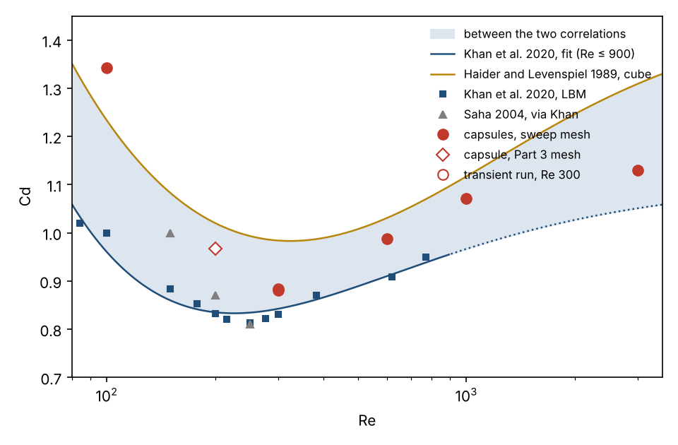
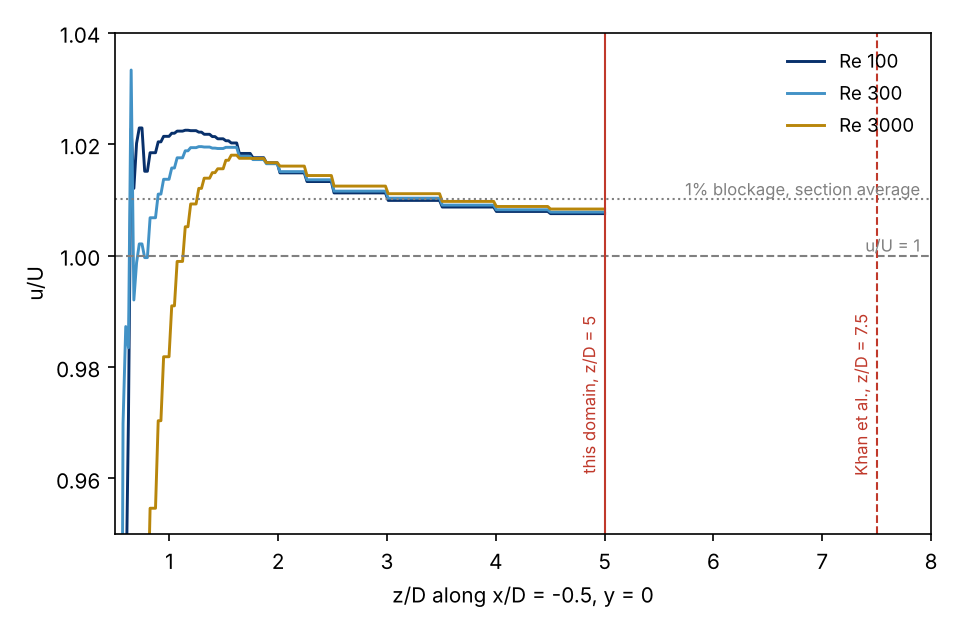

# Cube Drag Coefficient from $\mathrm{Re} = 100$ to $\mathrm{Re} = 3000$: Six Simulation Capsules Against the Literature

*CFD drag, recirculation length and Strouhal number of a cube in laminar flow, checked against a lattice Boltzmann study and two drag correlations, with the definition of every number next to the number.*

Francisco Ezquerra Larrodé · October 2026

## The question

A Simulation Capsule of the cube reports drag coefficient, recirculation length and base pressure as plain scalars, and whoever opens one asks first: are these numbers right? The capsule cannot answer that. It can say how it measured each number, which is a different question, and the answer to the first one has to come from outside. For a cube in uniform laminar flow the nearest outside source is the lattice Boltzmann study of [Khan, Sharma and Agrawal (2020)](https://doi.org/10.1115/1.4044821), which spans $\mathrm{Re} = 84$ to 770, carries force histories and Strouhal numbers, and checks itself against simulations by [Saha (2004)](https://doi.org/10.1063/1.1688324) and experiments by [Klotz et al. (2014)](https://doi.org/10.1017/jfm.2014.236).

This note sets the six published cube capsules of the [simulation-capsule repository](https://github.com/pacoEzq/simulation-capsule) beside that study. It is not a validation. It is a table, two figures, and one hypothesis that I tested and then dropped.

## The reference values

Khan et al. simulate a suspended cube of side $D$ on a cubic lattice, 12 nodes per side, inside a box of 25D by 15D by 15D: rear face 8D downstream of the inlet, free-slip walls, blockage 0.44%. Their grid study moves $C_d$ by 1 to 2% between 12 and 20 nodes. Four regimes emerge. Steady and axisymmetric up to $\mathrm{Re} = 200$; steady but no longer axisymmetric from 215 to 250; unsteady with one symmetry plane kept from 276 to 300; unsteady with none beyond 339. To their own points they fit a drag correlation valid for $\mathrm{Re} \le 900$,

$$C_d = \frac{24}{\mathrm{Re}}\left(1 + 1.059\,\mathrm{Re}^{0.09412}\right) + \frac{1.106}{1 + 237.4\,\mathrm{Re}^{-1}},$$

and set it beside the cube coefficients of [Haider and Levenspiel (1989)](https://doi.org/10.1016/0032-5910(89)80008-7) in the same functional form, $a = 0.2734$, $b = 0.5510$, $c = 1.406$, $d = 762.39$, $e = -1$. The two curves differ by 10 to 20% across the range, with Khan's below. So the published values themselves carry a spread wider than any single solver's error. Khan's values are the reference for this note, and Haider and Levenspiel mark the far edge of the band.

Three definitions decide which numbers can be compared at all.

| quantity | Khan et al. | the capsules |
|---|---|---|
| $C_d$ | force from wall stresses over $\tfrac{1}{2}\rho U^2 D^2$; time mean where unsteady | `forces.cd` from the force coefficient report, same reference; where the steady run never converged, an iteration mean over the stationarity windows, and `cd_statistic` says so |
| $L_r\text{/}D$ | from the centre of the rear face along the wake axis to where $u$ changes sign | `wake.recirculation_length_D`, same origin, same criterion ($u\text{/}U < 0$); in the sweep, the mean of instantaneous lengths and not the length of the mean field |
| $\mathrm{St}$ | $fD\text{/}U$ of the side force in a transient simulation | in no capsule; a steady run has no clock, see below |

Origin and criterion agree for $L_r$, so that column compares like with like; drag does too, provided the flow stays steady.

## The sweep against the literature

Five capsules of the Part 7 sweep share one Simcenter STAR-CCM+ mesh of 501,860 cells, generated once and reused at every Reynolds number, so any change from one row to the next comes from the Reynolds number and from nothing else.

| $\mathrm{Re}$ | capsule | $C_d$ | $L_r\text{/}D$ | Khan $C_d$ | Khan correlation | Haider and Levenspiel | Khan $L_r\text{/}D$ |
|---|---|---|---|---|---|---|---|
| 100 | `capsule_cube_re0100`, converged | 1.342 | 1.47 | about 1.0 | 0.960 (+40%) | 1.233 (+9%) | about 1.65 |
| 300 | `capsule_cube_re0300`, no steady state | 0.880 | 2.29 ± 0.15 | 0.83 | 0.842 (+4%) | 0.984 (-11%) | about 2.7 |
| 600 | `capsule_cube_re0600`, stationary | 0.987 | 2.40 ± 0.30 | 0.908 at $\mathrm{Re} = 620$ | 0.910 (+8%) | 1.030 (-4%) | |
| 1000 | `capsule_cube_re1000`, stationary | 1.071 | 2.41 ± 0.46 | | 0.967 (+11%, extrapolated) | 1.117 (-4%) | |
| 3000 | `capsule_cube_re3000`, stationary | 1.129 | 2.24 ± 0.62 | | 1.051 (+7%, extrapolated) | 1.309 (-14%) | |

I read the reference $L_r$ at $\mathrm{Re} = 100$ and 300 off their figure 4, since they tabulate neither; the ± on ours is the standard deviation across windows that each file reports.

Figure 1. Cd against Re. Filled circles: the sweep capsules. Open diamond: the Part 3 capsule on another mesh. Open circle: the transient run at Re = 300. Squares and triangles: Khan et al. and Saha. The shaded band spans the two correlations.

From $\mathrm{Re} = 300$ upwards the capsules sit inside the band, 4 to 11% above the LBM fit and 4 to 14% below Haider and Levenspiel, which is where a steady run of 500k cells on a single mesh should be expected to land. At $\mathrm{Re} = 300$ the transient run of the [steady-versus-transient study](../cube-re300/README.md) gives $C_d = 0.883$ and $\mathrm{St} = 0.099$ against 0.83 and 0.098, and reproduces the signature of their regime 3 too: one side force constant, the other oscillating, one symmetry plane kept. Drag comes out 6% high; frequency and symmetry class match.

At $\mathrm{Re} = 100$ the capsule sits outside the band: drag 34% above Khan's "around 1" and 9% above Haider and Levenspiel, recirculation bubble about 10% shorter. Wherever Khan et al. give a recirculation length, ours falls short by 10 to 15% while drag runs high. Both deviations point the same way, to a wake that closes sooner than in the reference, and the $u\text{/}U < 0$ criterion, applied cell by cell on a 0.25D grid, shortens the measured bubble further.

## The hypothesis I dropped

Mesh was the first suspect, and the [corner refinement study](../cube-re100/README.md) had already cleared it: four meshes at $\mathrm{Re} = 100$, $C_d$ between 1.335 and 1.342 on every one. The second suspect was the box. Our sweep inherits the Part 3 domain, 10D wide and 10D high with the inlet 5D upstream, so blockage is 1% against their 0.44%, and walls sit at 5D against their 7.5D. Free-slip walls closing in on a body at low Reynolds number raise its drag, viscous displacement of a cube at $\mathrm{Re} = 100$ reaches far, and the test was cheap: a line probe on the symmetry plane at cube height, $x\text{/}D = -0.5$, running from the wall at $z\text{/}D = 0.5$ to the boundary at 5, exported from saved solutions of three sweep points without solving anything.

Figure 2. u/U against z/D along the line x/D = -0.5, y = 0. Dashed: u/U = 1. Dotted: the 1% that mass conservation already demands as a section average. Red: the lateral boundary of this domain at z/D = 5 and of Khan et al. at 7.5.

Beyond $z\text{/}D$ of about 2 the three curves are one curve. At the boundary $u\text{/}U$ reads 1.0075 at $\mathrm{Re} = 100$, 1.0078 at 300 and 1.0083 at 3000, under the 1% that blockage alone accounts for, and with no trend. A wall at 5D squeezes the flow at $\mathrm{Re} = 100$ exactly as little as at 3000. Whatever lifts drag 34% above Khan's value, it is not confinement by the lateral walls, and I deleted the paragraph I had written about it.

Two candidates remain. I have not measured either of them yet. The first is the reference itself. At $\mathrm{Re} = 100$ friction is 22% of drag, 0.29 of 1.34. A lattice Boltzmann cube with 12 nodes per side and bounce-back walls resolves shear on its faces coarsely, and their grid study checks only the total drag, where a friction error is hard to see. It reports 1 to 2%. "Around 1" sits below even Haider and Levenspiel, whose correlation comes from settling experiments, and against that experimental reference our capsule is 9% high rather than 34%. The second is the inlet. A uniform velocity imposed 5D upstream of a body whose influence at $\mathrm{Re} = 100$ reaches several diameters ahead trims that influence off. The same probe macro, pointed along the axis from the inlet to the front face, would tell how much. That is the next version of this note.

## The Part 3 mesh

`capsule_cube_re200`, from Part 3, is a different simulation: 405,673 cells, two prism layers against twelve, built three months earlier on another release. It has no place in the table above. It belongs here because $\mathrm{Re} = 200$ is the best documented Reynolds number in the literature, the top of regime 1, where Khan et al. and Saha both tabulate drag and recirculation length.

| source | $C_d$ | $L_r\text{/}D$ |
|---|---|---|
| `capsule_cube_re200` | 0.967 | 2.16 |
| Khan et al. (2020) | 0.832 | 2.54 |
| Saha (2004) | 0.87 | 2.65 |
| Haider and Levenspiel | 1.020 | |

Same pattern as the sweep: 16% above Khan, 5% below Haider and Levenspiel, bubble 15% short, on a different mesh in the same box. When two different meshes deviate from the reference in the same way, the cause lies in what the two have in common, and after the probe above that is no longer the lateral walls. The two also share the inlet.

## What the capsules did not carry

Building this table required three pieces of information that no capsule contains.

Domain extents. Only `capsule_cube_re200` declares them in `summary.json`; sweep files carry 501,860 cells and nothing about the box around them. The comparison depended on that quantity, if only to rule it out, and five files out of six lacked it.

Strouhal number and side-force phase. Khan et al. draw their regime boundaries from force histories: whether side forces stay constant, whether one oscillates while the other holds, whether they correlate at all. A steady run has no physical time, so none of that exists in its capsule, and the transient row for $\mathrm{Re} = 300$ comes from the companion study instead.

The symmetry class of the wake. Our chain already checks mirror-image pairs of points on one plane and reports the largest difference; the classification of Khan et al. is that same check on two planes plus a steadiness flag. The ingredients of a regime label are all there; nobody has assembled them yet.

Each is a line in `summary.json`, not a new artifact. Whether they belong in the specification is the specification's question; what this note shows is that they are the first things a reader looks for when comparing a capsule with the literature.

## What to take away

A scalar in a capsule can only be compared when its definition travels with it, and definitions are where these files did well: `recirculation_length_D` says where it starts and what it thresholds, `cd_statistic` says what kind of mean it is. The numbers themselves sit inside the published spread from $\mathrm{Re} = 300$ up and outside it at $\mathrm{Re} = 100$; the probe rules out the lateral walls and leaves the inlet and the reference itself as open questions. Checking the capsules against published values costs little. The table took one afternoon and the probe one hour. In that time, the comparison exposed a line that `summary.json` should carry and does not, the domain extents, and it eliminated one plausible explanation for the drag at $\mathrm{Re} = 100$, the lateral walls. No self-test in the chain had caught either of those.

## References

- Khan, M. H., Sharma, A., Agrawal, A. (2020). Simulation of flow around a cube at moderate Reynolds numbers using the lattice Boltzmann method. *Journal of Fluids Engineering* 142(1), 011301. [doi:10.1115/1.4044821](https://doi.org/10.1115/1.4044821)
- Saha, A. K. (2004). Three-dimensional numerical simulations of the transition of flow past a cube. *Physics of Fluids* 16(5), 1630. [doi:10.1063/1.1688324](https://doi.org/10.1063/1.1688324)
- Klotz, L., Goujon-Durand, S., Rokicki, J., Wesfreid, J. E. (2014). Experimental investigation of flow behind a cube for moderate Reynolds numbers. *Journal of Fluid Mechanics* 750, 73. [doi:10.1017/jfm.2014.236](https://doi.org/10.1017/jfm.2014.236)
- Haider, A., Levenspiel, O. (1989). Drag coefficient and terminal velocity of spherical and nonspherical particles. *Powder Technology* 58(1), 63. [doi:10.1016/0032-5910(89)80008-7](https://doi.org/10.1016/0032-5910(89)80008-7)
- Companion notes in this repository: [Steady vs Transient CFD of Vortex Shedding: a Cube at Re = 300](../cube-re300/README.md) and [Pressure Singularity at a Sharp Corner: Mesh Refinement of a Cube at Re = 100](../cube-re100/README.md).

---

Khan et al. values are quoted from the text and tables of their article; no figure or table of theirs is reproduced, and values marked "about" are read from their figure 4. The capsule values come from the `main` branch of this repository on 17 October 2026. The figures are drawn by [`fig_cube_anchors_cd.py`](fig_cube_anchors_cd.py) from [`cube_anchors_cd.csv`](cube_anchors_cd.csv) and by [`fig_cube_anchors_lateral.py`](fig_cube_anchors_lateral.py) from `lateral_re0100.csv`, `lateral_re0300.csv` and `lateral_re3000.csv`, exported by [`lateral_probe.java`](lateral_probe.java); all in this folder. Text, figures and data are [CC BY 4.0](../../LICENSE-DOCS); the scripts and the macro are [MIT](../../LICENSE).

Personal project by [Francisco Ezquerra Larrodé](https://github.com/pacoEzq), published with the [simulation-capsule](https://github.com/pacoEzq/simulation-capsule) repository. Views are my own.
