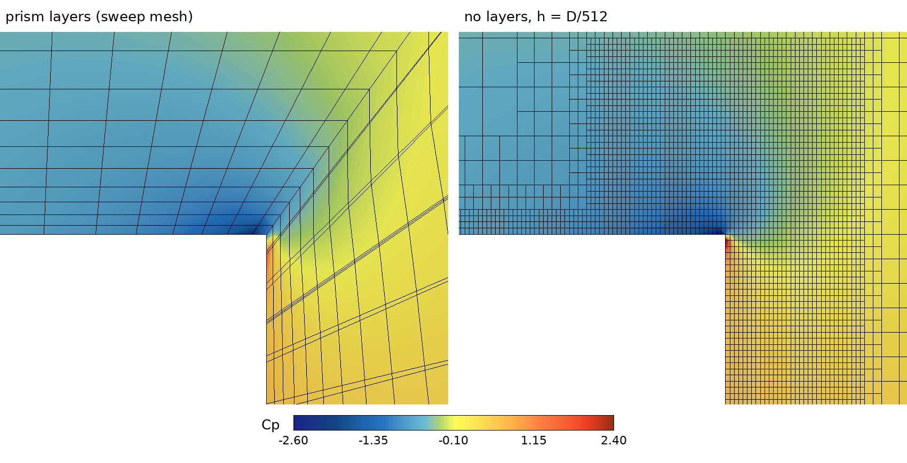
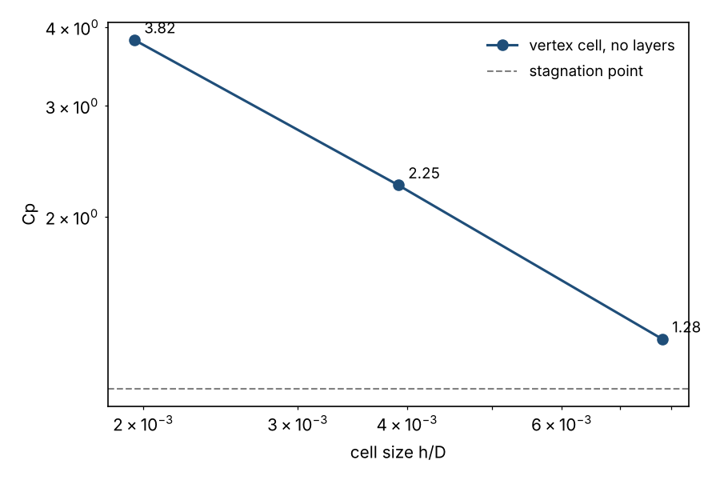
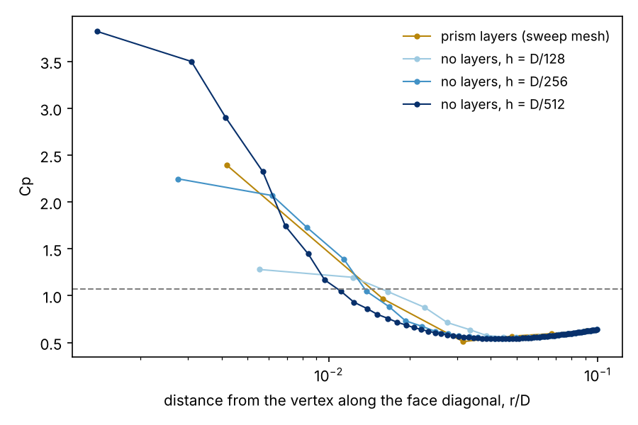

# Pressure Singularity at a Sharp Corner: Mesh Refinement of a Cube at $\mathrm{Re} = 100$

*Refine the corner and the peak grows: four meshes, one vertex, and a pressure coefficient that never settles.*

Francisco Ezquerra Larrodé · October 2026

## The question

This is a mesh refinement study of the pressure coefficient at a sharp corner, run in Simcenter STAR-CCM+ on a cube in laminar flow, with and without prism layers. It starts from the Simulation Capsule of the cube at $\mathrm{Re} = 100$, which reports two stagnation values that disagree. Its `cp_stagnation` reads 2.394, the largest cell value of $C_p$ on the cube. The symmetry plane, which passes through the real stagnation point, finds 1.068. From $\mathrm{Re} = 300$ upwards the two agree to 0.001; at $\mathrm{Re} = 100$ the larger one sits in a single cell at a corner of the front face. The note that ships with the capsule names the likely cause, the pressure singularity of viscous flow at a sharp corner, and says plainly that nobody had tested it.

There was a second suspect. That corner cell is not a good cell: the prism layers wrap around the vertex and fan out there. Was 2.394 the flow, or the mesh?

## The suspect cell

The capsule comes from the Reynolds sweep in [Part 7b](https://community.sw.siemens.com/s/question/0D5Vb00001dtHuCKAU/preparing-cfd-output-for-large-language-models-7b10-four-reynolds-numbers-the-cube-that-would-not-sit-still) of my series on preparing CFD output for language models. The cube has side $D$ in a uniform stream $U$, the flow is laminar and steady, and the mesh has 501,860 cells with 12 prism layers, 0.167D thick in total. I exported every cell on the cube from the saved solution, without running anything, with its $C_p$ and three quality measures.

The peak sits in the face cell that touches the vertex, at $r\text{/}D = 0.0042$ from it. Its cell quality is 0.26 and its skewness 54°; the median face cell scores 0.99 and 5°. Three of the four front vertices read 2.394. The fourth reads 2.054 and carries the lowest $C_p$ on the body as well, -3.513 on the neighbouring side face, where its siblings read -2.74. The geometry of those four cells is identical, so that asymmetry comes from the solution. A bad cell and an odd vertex: on that evidence the mesh looked guilty.

## Changing the layers

The first variant kept the layers and changed how they end. STAR-CCM+ has a switch for that, Enhanced Quality Prisms, which thins the layers towards convex edges and drops them one by one instead of fanning them out. A local Convex Angle Limit does not do this here: with the default thresholds it removes the layers from the cube altogether.

The vertex got worse. Its cell now read 3.338, the four vertices disagreed with each other, and a cell at $r\text{/}D = 0.0036$ read 2.14, lower than one further out. When the cells are degenerate the value follows their shape, not their distance from the corner. Drag hardly moved: $C_d$ went from 1.342 to 1.346.

## Removing them

The decisive test drops the layers from the cube and lets the trimmer fill the corner with cubes. Three refinement levels followed, each halving the cell size $h$ on the cube faces and in a box around the front face; every cell there scores a quality of 1.00. Each run went 3,000 iterations from scratch, the same as the sweep.

| | prism layers | $h = D\text{/}128$ | $h = D\text{/}256$ | $h = D\text{/}512$ |
|---|---|---|---|---|
| cells | 501,860 | 1,551,792 | 3,567,568 | 19,531,824 |
| $C_d$ | 1.3419 | 1.3351 | 1.3386 | 1.3383 |
| $C_p$, vertex cell | 2.394 | 1.280 | 2.247 | 3.820 |
| $C_p$, edge cell at mid-span | 0.51 | 0.43 | 0.81 | 1.40 |
| $C_p$, face centre | 1.069 | 1.069 | 1.070 | 1.070 |
| lowest $C_p$ on the body | -3.513 | -2.534 | -3.124 | -3.911 |

*Cp in the plane through the vertex and the diagonal of the front face. The white region is the cube and the flow arrives from the right. Values outside -2.6 to 2.4 are clamped.*

With perfect cells the vertex value grows by a factor of 1.7 at every halving of $h$, roughly as $h^{-0.7}$, and the cell beside the edge does the same. The corner is singular. On the coarse trimmer mesh the singularity simply went unresolved: 1.280 was not the true value, only the first point of a curve that keeps rising. That the prism mesh lands near 2.4 tells you its cell size at the vertex, nothing more. The four vertices agree on every trimmer mesh, so the odd vertex of the sweep mesh was the one real mesh effect in the story.

*Vertex-cell Cp on three trimmer meshes without prism layers. The dashed line is the stagnation value.*

The theory gives a reference slope. Stokes flow around a two-dimensional convex corner of 270° has a pressure that grows as $r^{-0.46}$ towards the edge ([Dean and Montagnon 1949](https://www.cambridge.org/core/journals/mathematical-proceedings-of-the-cambridge-philosophical-society/article/abs/on-the-steady-motion-of-viscous-liquid-in-a-corner/4CBD05192CACC84E841D3953DE88EB45); [Moffatt 1964](https://doi.org/10.1017/S0022112064000015)). The measured slope is steeper. Three meshes do not separate the candidates: inertia at $\mathrm{Re} = 100$, the three-dimensional vertex, or a range of $h$ that is not yet asymptotic.

## What converges

Everything a short distance away. Along the face diagonal, $C_p$ at $r\text{/}D = 0.04$ reads 0.571, 0.547 and 0.542 on the three trimmer meshes; at 0.02 it reads 0.95, 0.72 and 0.67. Only the last few cells next to the vertex keep climbing, and they get fewer and smaller with every level. Drag changes by 0.02% between the two finest meshes, so the singularity is integrable, and the stagnation point stays at 1.070. The recirculation length behind the cube reads 1.47D on all three.

*Cp of the front-face cells along the diagonal towards one vertex. Beyond r/D = 0.03 the four meshes agree; closer in, each finer mesh reaches higher.*

## Back to the sweep

The vertex cell of the sweep mesh can be read in every capsule of the sweep. It falls as $a + b\text{/}\mathrm{Re}$: 2.394 at $\mathrm{Re} = 100$, then 0.692, 0.186, -0.021 and -0.334 at 300, 600, 1000 and 3000. That is why the two stagnation values agree from 300 upwards. The singularity is still there; it weakens with Reynolds number and drops below the stagnation pressure, so the largest cell value happens to be the right one.

> [!NOTE]
> On a body with sharp edges at low Reynolds number, the largest cell value of $C_p$ is not a property of the flow. It depends on the size of the cell that touches the corner, and it keeps rising as that cell gets smaller. To report a stagnation pressure, read $C_p$ where the flow actually stops: on this cube, the centre of the front face, where the symmetry plane gives 1.068.

## What to take away

If the highest pressure on a body sits in the cell next to a sharp corner, do not report it before refining that corner with good-quality cells. Distorted cells can mislead in either direction. Here they made one vertex differ from the other three, they made the enhanced-layer mesh worse rather than better, and they produced a value that looked reasonable while the true one was still growing. A converged drag coefficient does not settle the question: drag is an integral over the whole body and converges long before the corner does.

The capsule is [`capsule_cube_re0100`](https://github.com/pacoEzq/simulation-capsule/blob/ef2252f/examples/capsule_cube_re0100/summary.json) in the `examples/` folder of the [simulation-capsule repository](https://github.com/pacoEzq/simulation-capsule), and its [note](https://github.com/pacoEzq/simulation-capsule/blob/ef2252f/examples/capsule_cube_re0100.md) already tells the reader to use 1.068. This article is the refinement study that note said was missing.

---

The figures are drawn by [`fig_cube_re100_corner.py`](fig_cube_re100_corner.py) from [`cube_re100_corner_diagonal.csv`](cube_re100_corner_diagonal.csv), both in this folder. Text, figures and data are [CC BY 4.0](../../LICENSE-DOCS); the script is [MIT](../../LICENSE).

Personal project by [Francisco Ezquerra Larrodé](https://github.com/pacoEzq), published with the [simulation-capsule](https://github.com/pacoEzq/simulation-capsule) repository. Views are my own.
