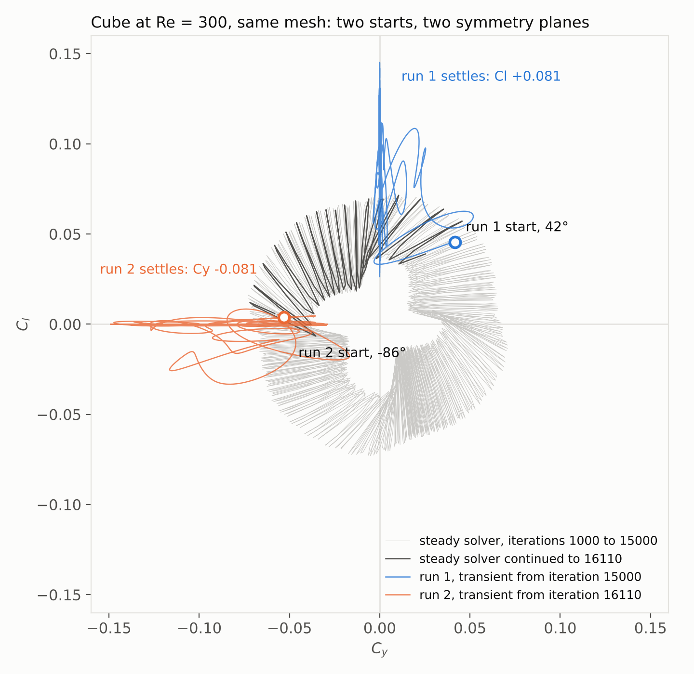
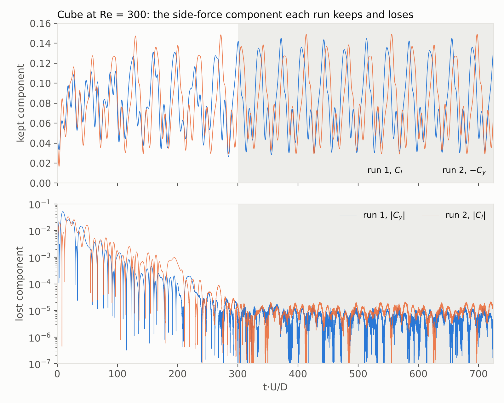

# Wake Symmetry Breaking in Transient CFD: How the Initial Condition Selects the Side-Force Plane of a Cube at $\mathrm{Re} = 300$

*Two transient simulations of the same cube wake, started from different steady iterates, break opposite symmetry planes: the initial condition selects the plane, while drag, side-force magnitude, Strouhal numbers and the 7:2 frequency lock stay the same to four digits.*

Francisco Ezquerra Larrodé · October 2026

## The question

Behind a cube in uniform laminar flow at $\mathrm{Re} = 300$ the wake sheds hairpin vortices, keeps one plane of symmetry and loses the other. You see it in the forces. One side-force component oscillates around a mean that is clearly not zero. The other stays at zero for as long as you care to run. [Khan, Sharma and Agrawal (2020)](https://doi.org/10.1115/1.4044821) find exactly this between $\mathrm{Re} = 276$ and 300, and they note that which plane goes is left to numerical noise. [Johnson and Patel (1999)](https://doi.org/10.1017/S0022112098003206) say the same of the sphere wake, and in the experiments of [Klotz et al. (2014)](https://doi.org/10.1017/jfm.2014.236) the support that holds the cube picks it. The transient run in [Steady vs Transient CFD of Vortex Shedding](../cube-re300/README.md) showed it too. Its lift coefficient $C_l$ settled at 0.081; the lateral coefficient $C_y$ fell to zero. So the wake has two equal ways to break its symmetry, and my run took one of them. Was that the mesh, the solver, or simply where the run began?

## Initial condition: a steady iterate with a turning side force

That transient run in Simcenter STAR-CCM+ did not start from rest. It started from the last iterate of a steady run, and a steady solver at this Reynolds number never settles: its side force, about 0.05 in magnitude, keeps turning around the stream axis, one turn every 3,870 iterations or so, and at iteration 15,000, where the steady run stopped, it pointed 42° from the $C_l$ axis towards $C_y$, a little closer to $C_l$ than to $C_y$. The transient run kept $C_l$.

So I turned the start. From the same steady run at iteration 15,000 I let the steady solver go on, checking the angle of the side force every 10 iterations on a running mean of 70, and stopped it when the force pointed along $-C_y$. That happened at iteration 16,110, at -86°, with $C_l = 0.006$ and $C_y = -0.058$. From there the run switched to the same transient set-up as before: implicit unsteady, second order in time, $\Delta t = 0.05D\text{/}U$, ten inner iterations per step, the same 501,860-cell mesh. It covered 725 time units, as the first one did.

The prediction was simple. If the start picks the plane, the new run keeps $C_y$ and loses $C_l$.

*Side force in the cross-flow plane. Grey: steady iterates 1,000 to 15,000; dark grey: the continuation to 16,110. Run 1 (blue) and run 2 (orange) over 0 to 725 time units, each ending on its own axis.*

## Side force, drag and Strouhal number in both runs

It did. $C_l$ fell below 0.001 after $t \cdot U\text{/}D = 165$ and below 0.0001 after 239, while $C_y$ settled around a negative mean. It held from then on. Over the settled window, $t \cdot U\text{/}D = 300$ to 725, the two runs read:

| | first run, started at 42° | second run, started at -86° |
|---|---|---|
| side force | $C_l = +0.0813$, rms 0.0336 | $C_y = -0.0813$, rms 0.0333 |
| other component | below 0.00002 | below 0.00002 |
| $C_d$ | 0.8828 | 0.8828 |
| $\mathrm{St}$, shedding | 0.0988 | 0.0988 |
| $\mathrm{St}$, modulation | 0.0282 | 0.0282 |
| repeats every | 70.9 time units | 71.0 time units |

*Top: the component each run keeps, Cl of run 1 and -Cy of run 2. Bottom: the component each run loses, on a log scale. Shaded: the settled window, t·U/D 300 to 725.*

Four digits agree in the mean side force, in the drag coefficient and in both Strouhal numbers. The fast shedding and the slow modulation lock 7:2 in both runs, so the whole signal repeats every 71 time units, and the slow modulation carries 79% of the fluctuation energy of the side force in each. Halves of the window agree to 0.0004. The second run is the first one turned a quarter of the way round the stream axis, nothing more.

## The initial condition selects the symmetry plane

The plane that breaks is not a property of this flow. The run inherits it. Here it came from wherever the steady solver had left the side force. What belongs to the flow is everything else, and that part holds to the last digit I can read: the size of the side force, how hard it swings, the drag, both frequencies and the 7:2 lock.

Two consequences follow for anyone who writes such a run down for later use, which is what a [Simulation Capsule](https://github.com/pacoEzq/simulation-capsule) does. First, a capsule of this case should report the magnitude of the side force and say that its direction is arbitrary, rather than give $C_l$ and $C_y$ as if they were two facts about the cube. Second, a comparison between two capsules of the same case, two meshes or two solvers, must not read a swapped plane as a difference: $C_l = 0.081$ against $C_y = -0.081$ is agreement, and a language model reading the two side by side has no way to know that unless the capsule tells it.

## Limits

One mesh, the medium one of the three in the earlier study. Two starts, 42° and -86°, and nothing in between; a start close to 45° might take longer to choose, or might split the difference for a while, and I have not tried it. Both starts came from the steady run. What a run from uniform flow would pick, I cannot say. The reference is a lattice Boltzmann study with 12 nodes per cube side, whose drag at this Reynolds number is about 6% below ours ([Cube Drag Coefficient from Re = 100 to Re = 3000](../cube-literature-anchors/README.md) sets the two side by side). I use it for the pattern, one plane kept and one lost; its numbers I leave aside.

---

Both runs use the set-up and mesh described in [Steady vs Transient CFD of Vortex Shedding](../cube-re300/README.md), whose folder holds the force history of run 1. Run 2 is in this folder: [`cube_re300_run2_steady_monitors.csv`](cube_re300_run2_steady_monitors.csv), iterations 15,010 to 16,110 every 10, and [`cube_re300_run2_transient_monitors.csv`](cube_re300_run2_transient_monitors.csv), one row per time step from $t \cdot U\text{/}D = 0.05$ to 725. Khan et al., Johnson and Patel, and Klotz et al. are cited from the text of their articles; no figure or table of theirs is reproduced. The figures are drawn by [`fig_cube_re300_symmetry_plane.py`](fig_cube_re300_symmetry_plane.py) from these files and the run 1 files. Text, figures and data are [CC BY 4.0](../../LICENSE-DOCS); the script is [MIT](../../LICENSE).

Personal project by [Francisco Ezquerra Larrodé](https://github.com/pacoEzq), published with the [simulation-capsule](https://github.com/pacoEzq/simulation-capsule) repository. Views are my own.
