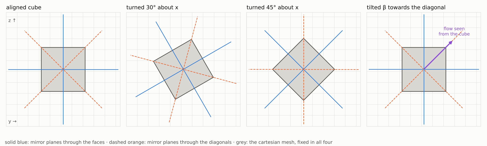
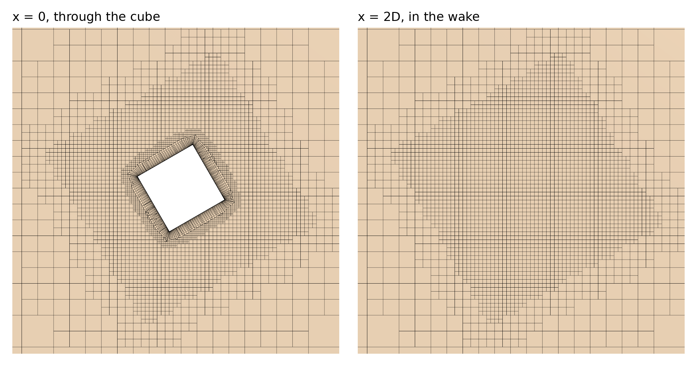
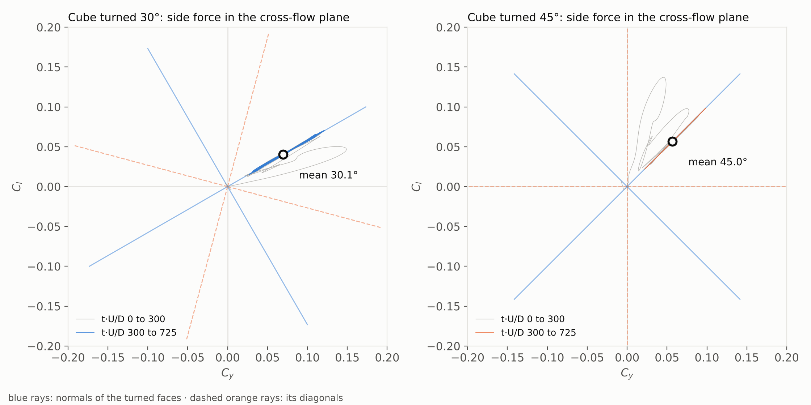
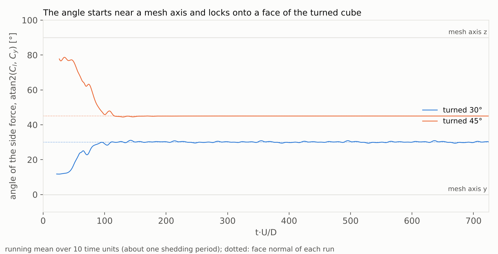
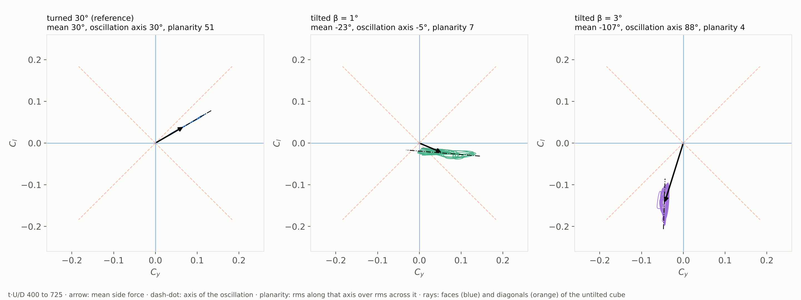
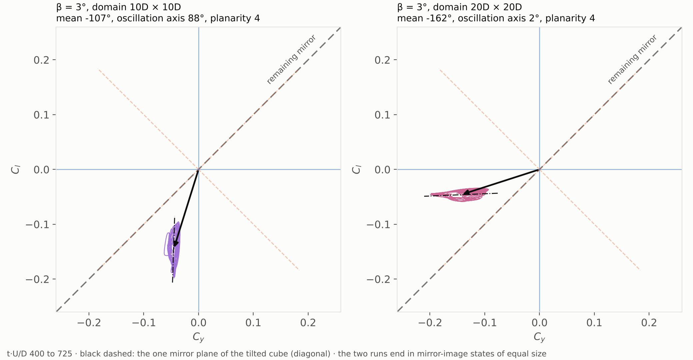

# Symmetry-Plane Selection in the Cube Wake at $\mathrm{Re} = 300$: Rotated, Tilted and Wide-Domain Runs

A cube facing the flow has two kinds of mirror plane, one pair through its faces and one through its diagonals, and at Re = 300 its wake keeps only one of them. To find out which, and whether a grid aligned with the faces made that choice, I turned the cube 30° and 45° about the stream axis inside a fixed cartesian mesh, and in a second set of runs I tilted it 1° and 3° towards a diagonal. Every run oscillates in a plane through a face. That holds at 45° too, where grid lines favour the diagonal. The mesh only decides which face. A tilt adds a steady push along its own direction, but it does not turn a diagonal into a plane. Read from mean streamwise vorticity two diameters downstream, the wake plane sits on a face in all six runs, and where it parts from the direction of the mean force, the gap is the incidence force of the tilt, not another plane. A domain twice as wide moves forces by less than 3%. The run lands on the mirror image of the narrow-domain state, across the single plane a tilted cube keeps.

Francisco Ezquerra Larrodé · October 2026

> **What is new**
>
> 1. **The face plane is the one the wake keeps.** Turned 30° and 45° in a fixed grid, side force lines up with a face normal of the turned cube to within 0.1°. Magnitude and drag do not change. No run selects a diagonal plane.
> 2. **The mesh acts only during linear growth.** At 45° every grid preference points at a cube diagonal. There the instability starts near a mesh axis and still ends on a face. The grid only decides which of four equivalent face states a run reaches; it never turns a face state into a diagonal one.
> 3. **Forced breaking does not create a diagonal state.** A cube tilted towards its diagonal keeps a face-plane oscillation. Its mean force is the sum of that face state and an incidence force along the tilt diagonal.
> 4. **The plane read from the wake agrees with the plane read from the force.** Mean streamwise vorticity at $x = 2D$ forms a pair of lobes, and the perpendicular bisector of their centroids is the wake plane. For turned cubes it matches force direction to 0.4°. For tilted cubes it lies 8 to 10° from mean force. That gap is the incidence component, which the vortex pair does not carry.
> 5. **Tilt destroys planarity first.** The ratio of along-axis to cross-axis rms falls from 51 for the untilted cube to 6.8 at β = 1° and 4.0 at β = 3°, so a 1° tilt changes the character of the oscillation more than its orientation. At β = 1° the instantaneous force direction swings through some 50° within one shedding period.
> 6. **Confinement is negligible, and the outcome respects the residual symmetry of the body.** In a domain of twice the cross-section, the tilted cube reaches the mirror-image state across its diagonal plane. Force magnitude (0.151 against 0.153), incidence component (0.065 against 0.064) and planarity (4.4 against 4.0) stay the same.

## The question

In [Wake Symmetry Breaking in Transient CFD](../cube-re300-symmetry-plane/README.md) two runs of the same cube at $\mathrm{Re} = 300$ broke opposite symmetry planes. The start of each run chose the plane; drag, side-force magnitude and both Strouhal numbers agreed to four digits. Both times the plane lay along a cube face, $C_l$ in one run, $C_y$ in the other. In that set-up, though, cube faces and mesh lines point the same way, so that each face is also a grid axis and an axis of the square domain around it.

Which of them offers the planes? If the cube does, turning it turns its planes too. If the grid does, the planes stay where they are and the cube turns underneath them. [Klotz et al. (2014)](https://doi.org/10.1017/jfm.2014.236) saw the first in an experiment: the wake plane followed the cube up to almost 30°, and beyond that it moved to the cube's vertical diagonal. A simulation lets me remove the support that holds the model and keep only the grid.

## Four configurations

*Figure 1. Seen from downstream, y to the right and z up. Solid blue: the two mirror planes through the faces. Dashed orange: the two through the diagonals. Grey: the cartesian mesh, which never moves.*

Facing the flow, a cube has the symmetry of a square: four quarter turns and four mirrors, two through faces, two through diagonals. When a wake breaks that symmetry it keeps one mirror, and earlier runs showed it keeps a face mirror. Turning the cube about the stream axis moves both pairs off the grid lines.

- **Turned 30°.** Face mirrors sit at 30° and 120°, diagonal mirrors at 75° and 165°. Nothing of the cube lines up with the grid.
- **Turned 45°.** Face mirrors sit at 45° and 135°. Diagonal mirrors now lie exactly on grid axes. This is the cube's hardest case: whatever bias the grid has pushes towards a diagonal.
- **Tilted β.** The cube stays aligned but leans by a small angle β, so that the flow it sees comes in at β towards the diagonal at 45°. That breaks symmetry on purpose, in a known direction. Only one mirror is left to it, the diagonal plane.

Every run uses the earlier study's set-up: Simcenter STAR-CCM+, laminar, implicit unsteady, second order in time, $\Delta t = 0.05D\text{/}U$, ten inner iterations, 725 time units from uniform flow. The domain runs from $x = -5D$ to $x = 15D$, 10D by 10D in cross-section (1% blockage), with slip side walls. Only geometry changes, and with it the mesh around the cube.

Three numbers describe each run. One is side-force angle, $\theta = \mathrm{atan2}(C_l, C_y)$, averaged over a window. Another is planarity: the rms of the fluctuating side force along its principal axis, divided by the rms across it. A flat oscillation has large planarity. An isotropic one has planarity 1. The third comes from the wake rather than the body: the angle of the plane of mean streamwise vorticity, defined in [the section on the wake plane](#the-plane-read-from-the-wake-vorticity-against-force).

A chain of part operations in STAR-CCM+ builds the turned cube from the aligned case, and the mesher rebuilds the mesh around it. The refined cells near the walls and the wake refinement block turn with the cube. The background grid stays where it is. The turned mesh has 507,940 cells, against 501,860 for the aligned one.

*Figure 2. Mesh sections of the cube turned 30°, taken in the simulation and seen from downstream, y to the right and z up. Left: x = 0, through the cube. Right: x = 2D, in the wake.*

## Turned 30° and 45°: the plane follows the cube

*Figure 3. Side force in the cross-flow plane. Grey: the first 300 time units. Colour: 300 to 725. Blue rays: normals of the turned faces. Dashed orange rays: its diagonals.*

Over the settled window, $t \cdot U\text{/}D = 300$ to 725:

| | aligned (earlier study) | turned 30° | turned 45° |
|---|---|---|---|
| side force, magnitude | 0.0813 | 0.0802 | 0.0802 |
| angle of the side force | 90° (on $C_l$) | 30.1° | 45.0° |
| nearest face normal | 90° | 30° | 45° |
| nearest grid axis | 90° | 0° | 0° / 90° |
| $C_d$ | 0.8828 | 0.8781 | 0.8782 |

In both turned runs, the force ends on the normal of a turned face, within 0.1°. Its size is the same in both and within 1.4% of the aligned cube; drag is about 0.5% lower. Turning the cube moved the plane. Nothing else changed, at least nothing I can read at this resolution.

The case at 45° is the one that matters. There, grid axes run along cube diagonals, so any grid preference points at the one state earlier runs never chose. This run starts there. Its angle grows near 80°, close to the mesh z axis, and stays there for the first 50 time units. It leaves after that and settles on the face at 45°, where it sits by $t \cdot U\text{/}D = 120$.

*Figure 4. Angle of the side force, smoothed over 10 time units, about one shedding period. Dotted: the face normal of each run.*

The 30° run does the same from the other side. It starts at 12°, near the mesh y axis, and reaches 30° by 110. The grid has a say, then, but only at the start, while the disturbance is small and grows almost linearly, and once the wake is fully nonlinear the cube takes over, so that the grid only decides which of four faces a run ends on. It is the one nearest to where growth began.

## Tilted 1° and 3°: a push along the diagonal, but the plane stays on a face

A turned cube still has the symmetry of a square, only rotated. A tilted cube does not. Its lean gives the flow a preferred direction, here the diagonal at 45°. If any small effect could make the wake choose a diagonal, this one should.

*Figure 5. Side force over t·U/D = 400 to 725. Arrow: mean side force. Dash-dot: axis of the oscillation. Planarity: rms of the force along that axis over rms across it.*

| | turned 30° | tilted β = 1° | tilted β = 3° |
|---|---|---|---|
| axis of the oscillation | 30° (face) | -5° (face $+y$) | 88° (face $z$) |
| mean side force | 0.081 at 30° | 0.062 at -23° | 0.153 at -107° |
| face part | 0.081 | 0.080 | 0.100 |
| tilt part (at -135°) | 0 | 0.034 | 0.064 |
| planarity | 51 | 6.8 | 4.0 |
| $C_d$ | 0.878 | 0.880 | 0.913 |

Two things happen at once. The oscillation stays on a face: -5° in one run, 88° in the other, each within 5° of a face of the untilted cube. Instead of adopting the one mirror a tilted cube still has, the wake breaks it. Mean side force, though, no longer points along that face. It is the sum of two parts: a face state along the oscillation axis, and a steady force from the tilt along the tilt diagonal, at -135° in the sign convention of these force reports. At β = 1° the split is clean. Its face part is 0.080, matching the aligned cube's 0.081, and its tilt part 0.034. At β = 3° the face part grows to 0.100 and the tilt part to 0.064, so the two no longer add independently.

The tilt does decide where growth begins. At $t \cdot U\text{/}D = 25$ the force points along the tilt diagonal, at 45° in one run and -134° in the other. From there the nonlinear part of the dynamics carries it to one of two faces next to that half-diagonal, as it carried the turned cubes. What the tilt costs is planarity. Square to the flow, a cube oscillates in a plane, with a ratio of 51 between the two directions. Tilted by 1°, that ratio falls to 6.8; by 3°, to 4.0. The wake still prefers a face, but it is no longer flat.

The 1° case shows what a planarity of 7 means in time. Over the last twenty time units of the run, about one and a half shedding periods, the instantaneous direction of the side force swings between -16° and -64°. Its mean is -34° and its standard deviation 15°, and the swing repeats with the shedding. The direction oscillates. It does not drift. Face state and incidence force are of comparable size here (0.080 against 0.034), and the force vector rocks between them once per cycle.

## The plane read from the wake: vorticity against force

Force belongs to the body. The plane belongs to the wake, and I can measure it there directly. I continued each run for twenty time units past $t \cdot U\text{/}D = 725$ with streamwise vorticity $\omega_x$ averaged in time, then cut that mean field at $x = 2D$. A cube's mean wake carries a pair of counter-rotating streamwise vortices, one lobe of positive $\bar{\omega}_x$ and one of negative, symmetric about the oscillation plane. Their centroids define a segment, whose perpendicular bisector is the mean wake's symmetry plane. Its angle in the cross-flow plane, $\theta_{\text{plane}}$, depends only on where the vortices sit. Force reports play no part, nor does any window chosen on them.

*Figure 6. Mean streamwise vorticity ω̄x at x = 2D over t·U/D = 725 to 745, seen from downstream, y to the right and z up, 256 levels on a common scale. Blue rays: face normals of the cube in each configuration. Black line: perpendicular bisector of the lobe centroids, the plane of the mean wake. Orange arrow: mean side force over the same window.*

| | aligned | turned 30° | turned 45° | tilted 1° | tilted 3° | tilted 3°, wide domain |
|---|---|---|---|---|---|---|
| $\theta_{\text{plane}}$, from $\bar{\omega}_x$ | 90.0° | 29.6° | 45.0° | -17.9° | 80.9° | 9.9° |
| $\theta_{\text{force}}$, mean side force | 90.0° | 30.0° | 45.0° | -27.5° | 73.1° | 17.8° |
| difference | 0.0° | 0.4° | 0.0° | 9.7° | 7.9° | 7.9° |
| nearest face normal | 90° | 30° | 45° | 0° | 90° | 0° |

*Both angles are angles of a line, reported in (-90°, 90°]; a force at -107° and one at 73° lie on the same line. Window: t·U/D = 725 to 745.*

For aligned and turned cubes, both readings agree to 0.4° and sit on a face. That is the earlier result, now taken from the wake instead of the body. It also settles whether force direction is a faithful proxy for the plane: for a cube square to the flow, it is.

For tilted cubes the readings differ by 8 to 10°. Which way they differ is the point. In all three tilted runs, the force lies between the vorticity plane and the tilt diagonal at -135°, so it is the vorticity reading pulled towards the direction of incidence. The vortex pair records the face state alone. The mean wake is still symmetric about a plane near a face of the untilted cube, at -18°, 81° and 10°. Mean force adds the tilt's steady push, which has no symmetric vortex pair of its own and so leaves both centroids where they are, and that is why force and vorticity measure separately the two parts of the previous section, face part and tilt part. Read from the wake, a tilted cube keeps a face plane as cleanly as a turned one. Read from the body, the plane seems to lean towards the diagonal, and that lean is the incidence force.

The wide-domain run shows the same on the mirror-image state. Its vorticity plane is on the face at 10° and its force at 18°, pulled by the same 8° towards -135° (that is, towards 45° as a line).

## Are the side walls confining the wake?

Side walls are slip walls 5D from the cube: a box 10D square in cross-section, 1% blockage. They are not symmetry planes of the flow; they stand in for the far field. Two things about them matter here.

For the turned cube they are a second square anisotropy, aligned with the grid. I cannot separate their effect from the grid's, but it is small for the same reason: at 30° and 45°, side-force magnitude and drag agree to the last digit I report.

For a tilted cube the question is different. A tilted body pushes fluid sideways, and in a box with slip walls the wake cannot leave sideways; the walls push back, as tunnel walls do on a lifting model. At β = 3°, mean side force is twice that of the aligned cube, which is large enough to ask whether part of it comes from the walls.

To check, I ran the 3° tilt again in a domain twice as wide: 20D square in cross-section, 0.25% blockage, same streamwise extent, mesh settings and time step.

*Figure 7. β = 3° in the 10D and the 20D domain, t·U/D = 400 to 725. Black dashed: the diagonal plane, the only mirror of the tilted cube. The two states are mirror images across it.*

| | 10D × 10D | 20D × 20D | change |
|---|---|---|---|
| mean side force, magnitude | 0.153 | 0.151 | -1.4% |
| angle of the mean | -107° | -162° | mirror (-135° ± 27.5°) |
| axis of the oscillation | 88° (face $z$) | 2° (face $y$) | mirror |
| face part | 0.100 | 0.097 | -3% |
| tilt part (at -135°) | 0.064 | 0.065 | +2% |
| planarity | 4.0 | 4.4 | |
| $C_d$ | 0.913 | 0.909 | -0.5% |
| angle at $t \cdot U\text{/}D = 25$ | -134° | -135° | |

Every part keeps its size to within 3%. Mean side-force magnitude changes by 1.4%, the tilt part by 2%, drag by 0.5%. Over three successive windows of 125 time units, mean force moves by less than 1.5% in both domains. At this blockage, the tilted results above are not an artefact of the walls. Confinement is ruled out.

Direction is another matter. It changes in a specific way. Both runs begin on the tilt diagonal at $t \cdot U\text{/}D = 25$, at -134° and -135°. The narrow domain then ends on face z, with its mean at -107°; the wide one ends on face y, with its mean at -162°. Those two are mirror images across the diagonal plane, the single symmetry a tilted cube keeps: -135° plus and minus 27.5°. A tilt defines a pair of equivalent states, and a change of domain, like a change of start, picks the other member of that pair.

The wide-domain case ran twice, once on my workstation and once on a cluster, both with 16 processes and the same solver version. The two monitor files are identical byte for byte.

## What this means for a capsule of the case

The earlier study concluded that a capsule of this case, the condensed record a language model reads, should report side-force magnitude and call its direction arbitrary. These runs say how arbitrary. Direction is one of four, fixed by the faces of the body, and which of the four depends on the start and on the grid. A [Simulation Capsule](https://github.com/pacoEzq/simulation-capsule) of a bluff-body wake should therefore carry three things: the orientation of the body relative to the grid, the angle of the side force relative to the body, and the planarity of the oscillation. Where a body is not square to the flow, it should also say which quantity gave the plane, force or wake, because the two differ by the incidence force. Two capsules of a single cube, one aligned and one turned, agree when the force sits on a face in both. A language model comparing them sees 90° against 30° and reads a difference, unless the capsule gives it a frame to read them in.

## Limits

One mesh, the medium one of the earlier study, and one Reynolds number. Each configuration ran once. The face a run lands on depends on its start and on how the solver splits the domain across processes, so a second run of the same case may land on a different face, as the earlier study showed. Both tilts are small and go one way, towards the diagonal. The tilted runs are not settled in the way the aligned ones are: their force does not repeat on a fixed cycle within 725 time units, so their planarity numbers describe this window. Vorticity planes come from a mean over twenty time units, about one and a half shedding periods. That fixes lobe centroids to the degree reported but does not average out the slow wander of the tilted wakes. The confinement check covers only β = 3°. Grid and square domain share their axes, so what I attribute to the grid is the effect of both.

## References

Klotz, L., Goujon-Durand, S., Rokicki, J. and Wesfreid, J. E. (2014). Experimental investigation of flow behind a cube for moderate Reynolds numbers. *Journal of Fluid Mechanics*, 750, 73-98. [doi:10.1017/jfm.2014.236](https://doi.org/10.1017/jfm.2014.236)

---

*Data files in this folder: `cube_re300_aligned_transient_monitors.csv`, `cube_re300_rot30_transient_monitors.csv`, `cube_re300_rot45_transient_monitors.csv`, `cube_re300_tilt1_transient_monitors.csv`, `cube_re300_tilt3_transient_monitors.csv` and `cube_re300_tilt3w_transient_monitors.csv`, one row per time step, columns tU_D, cd, cl, cy; and the mean-vorticity cuts `cube_re300_<tag>_slice_x2.csv` at $x = 2D$ over $t \cdot U\text{/}D = 725$ to 745, columns y, z, omega_x_mean, for the six configurations. The figure script [`fig_cube_re300_turned.py`](fig_cube_re300_turned.py) makes the force figures and also reads the aligned run from ../cube-re300/; [`fig_cube_re300_vorticity.py`](fig_cube_re300_vorticity.py) makes the vorticity figure and [`sym_plane_angle.py`](sym_plane_angle.py) the table of plane angles. The macro [`sym_rot30.java`](sym_rot30.java) builds and runs each configuration from the aligned case; its parameters are ROT_DEG, TILT_DEG, TILT_PHI_DEG and DOMAIN_SCALE; [`sym_mean.java`](sym_mean.java) and [`sym_table.java`](sym_table.java) continue a run with the time-averaged vorticity and export the cut. Klotz et al. are cited from the text of their article; no figure or table is reproduced. Text, figures and data are [CC BY 4.0](../../LICENSE-DOCS); the scripts and the macros are [MIT](../../LICENSE).*

Personal project by [Francisco Ezquerra Larrodé](https://github.com/pacoEzq), published with the [simulation-capsule](https://github.com/pacoEzq/simulation-capsule) repository. Views are my own.
