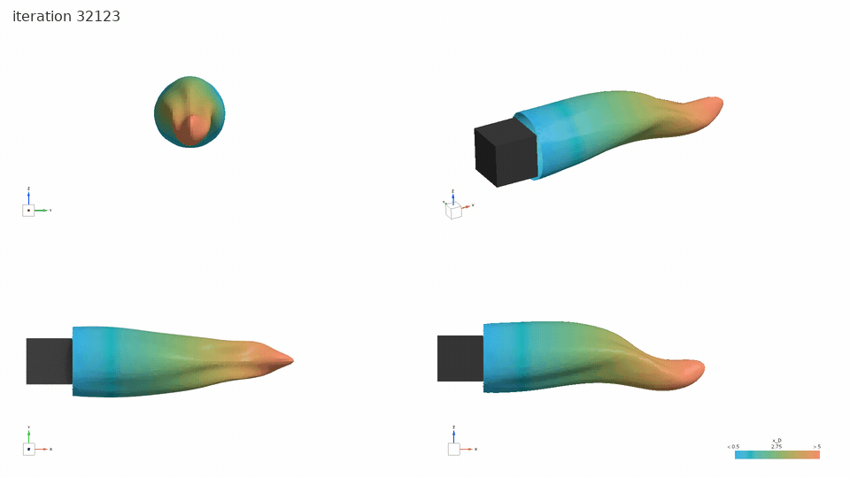
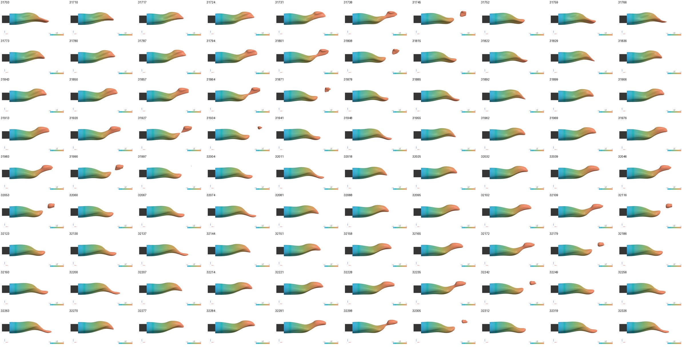
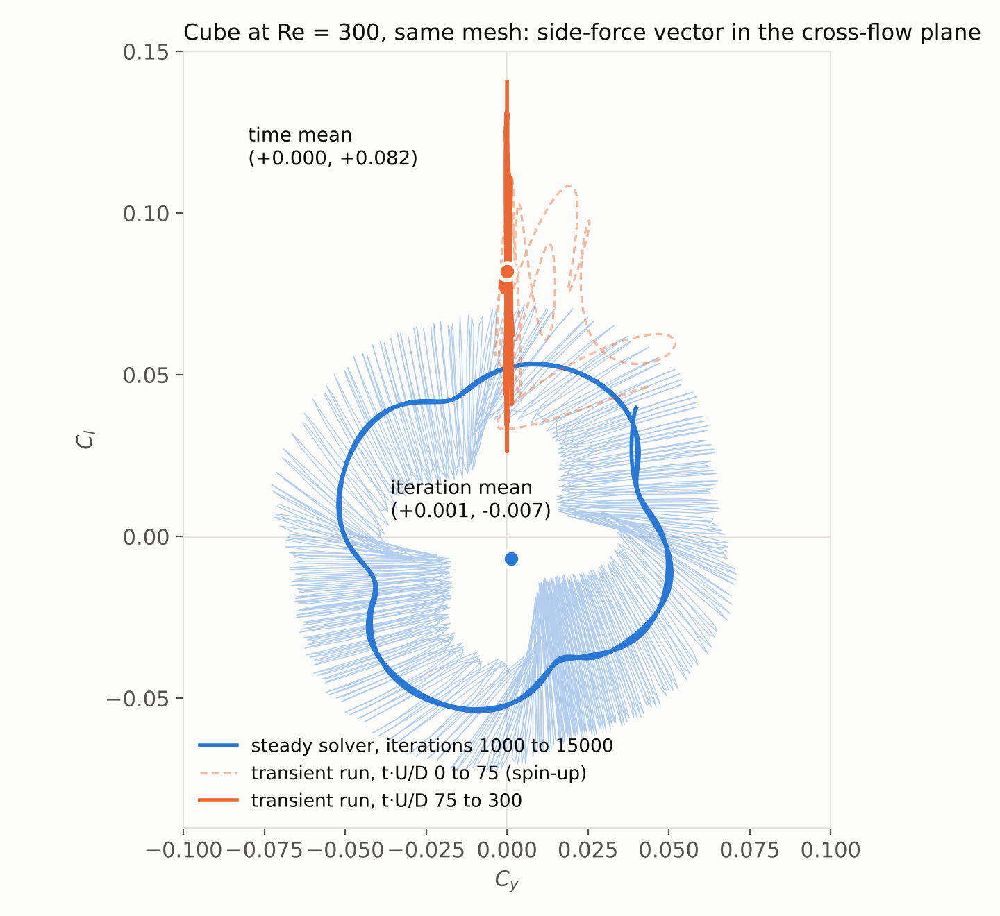
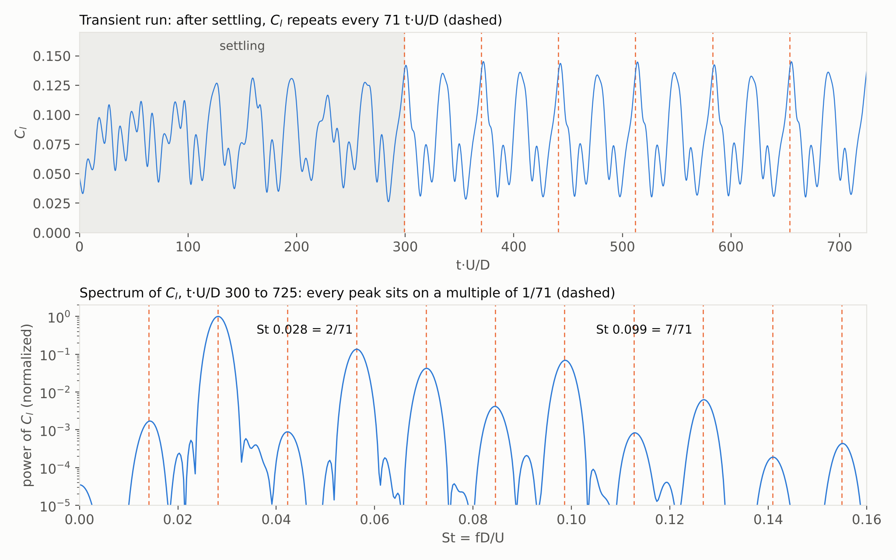
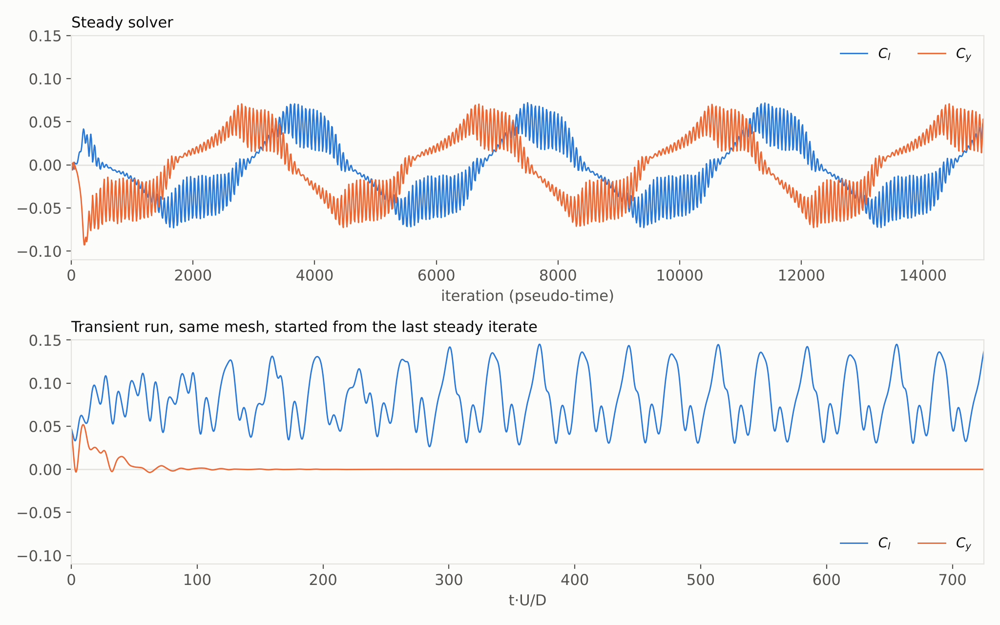

# Steady Solver, Unsteady Wake: a Cube at $\mathrm{Re} = 300$

*Same mesh, two solvers, and a side force that only one of them gets right.*

Francisco Ezquerra Larrodé · October 2026

## The question

Run a steady solver on a flow that is not steady and it will still hand you numbers. The monitors fall into some kind of rhythm, the residuals stop dropping, and sooner or later somebody averages the last few thousand iterations and calls that the answer. How far off is it? The test case had to be small enough to repeat: a cube in uniform flow at $\mathrm{Re} = 300$, close to where the literature places the onset of vortex shedding, between $\mathrm{Re} = 255$ and 305. I ran it twice on the same mesh, once with the steady segregated solver in Simcenter STAR-CCM+ and once with an implicit unsteady run that started where the steady one stopped.

## Same mesh, two runs

The cube has side $D$ and sits in a uniform stream $U$. The flow is laminar, with $\mathrm{Re} = UD\text{/}\nu = 300$. The mesh has 501,860 cells, a base size of $0.5D$ and surface cells down to $0.05D$. It is the mesh of the Reynolds sweep in [Part 7b](https://community.sw.siemens.com/s/question/0D5Vb00001dtHuCKAU/preparing-cfd-output-for-large-language-models-7b10-four-reynolds-numbers-the-cube-that-would-not-sit-still) of my series on preparing CFD output for language models. Two more meshes came later; what they change is at the end of the setup section.

The steady run stopped at 15,000 iterations. From its last iterate the transient run switched the time model to implicit unsteady, second order in time, with $\Delta t = 0.05D\text{/}U$ and ten inner iterations per step, and covered 725 time units: 14,500 steps, or 145,000 more iterations.

## What the steady solver reports

Drag behaves. Seven windows of 2,000 iterations give $C_d$ between 0.8796 and 0.8802, a mean of 0.880.

The side force does something else. Its two components, $C_l$ and $C_y$, swing slowly a quarter turn apart, so the force vector, about 0.05 in magnitude, turns around the stream axis once every 3,870 iterations or so, 3.6 turns in all; [Part 7b](https://community.sw.siemens.com/s/question/0D5Vb00001dtHuCKAU/preparing-cfd-output-for-large-language-models-7b10-four-reynolds-numbers-the-cube-that-would-not-sit-still) shows that loop in detail. Averaged over the iterations, it comes out as $C_l = -0.007$ and $C_y = +0.001$. According to the steady solver, the cube feels no mean side force.

The fast flutter has a shape in the wake. I let the same steady run continue past 15,000 iterations and, from iteration 31,703 on, saved a frame every 7 iterations. The surface where $u\text{/}U = 0.5$ trails behind the cube, bends, and pinches off a blob at its tail; the next blob leaves about 63 iterations later, the same period as the flutter in $C_l$. Each frame is an iteration, not an instant.

*Steady solver, iterations 32,123 to 32,242, one frame every 7 iterations. Isosurface u/U = 0.5 coloured by x/D from 0.5 to 5, seen from downstream, in isometric view, from above and from the side.*

*Ninety frames of the same isosurface, one every 7 iterations from 31,703 to 32,326. A blob leaves the tail about every 63 iterations.*

## What the flow does

The transient run disagrees. Within the first 75 time units the force stops turning: $C_y$ falls from 0.04 to below 0.002 and stays there, under 0.0005 after $t \cdot U\text{/}D = 150$ and under 0.00002 after 300, while $C_l$ climbs and settles around a positive mean. The swings of $C_l$ keep growing until about $t \cdot U\text{/}D = 300$, so I take the statistics after that. Over $t \cdot U\text{/}D = 300$ to 725 the time means are $C_d = 0.883$ (rms 0.009), $C_l = 0.081$ (rms 0.034) and $C_y = 0.0000$. Split that window in two and the halves agree to 0.0005 in $C_l$ and 0.0001 in $C_d$. Not once does $C_l$ cross zero: for 425 time units it stays between 0.028 and 0.145.

*The steady iterates circle the origin; the transient force leaves the ring and stays on one axis.*

In the cross-flow plane the two runs look like different cases. The steady iterates trace a ring of radius about 0.05, and their mean sits in the middle of it, 0.012 or more from every iterate after the first thousand. The flow, given a clock, picks a plane, here the plane of $C_l$, and keeps pushing the cube towards one side of it. Nothing in the geometry prefers $+C_l$ over the other three lateral directions, so a different starting state would probably pick a different one with the same magnitude.

| | steady, iterations 1,000 to 15,000 | transient, $t \cdot U\text{/}D$ 300 to 725 |
|---|---|---|
| $C_d$ | 0.880 | 0.883 |
| $C_l$ | -0.007 | 0.081 |
| $C_y$ | 0.001 | 0.000 |
| side force | about 0.05, turning | 0.081, fixed |
| time scales | 3,870 and 63 iterations (pseudo-time) | $\mathrm{St} = 0.099$ and 0.028, locked 7:2 |

Drag came out of the steady run 0.3% low. Nobody would reject a drag value for that. The side force came out as zero instead of 0.081, and that is no rough estimate of the time mean. It is a different quantity, the average over a rotation the real wake never performs.

## Two clocks

Iterations are pseudo-time. Their 3,870 per turn is not a frequency, and only the transient run can say how fast anything happens. Its history of $C_l$ carries two time scales, and they are locked together. A fast oscillation at $\mathrm{St} = fD\text{/}U = 0.099$, a period of about 10 time units, rides on a slow modulation at $\mathrm{St} = 0.028$, about 35 time units. Seven fast periods fit into exactly two slow ones, so once the wake has settled the whole signal repeats every 71 time units, and every peak of its spectrum sits on a multiple of $1/71$. The slow modulation holds 90% of the fluctuation energy of $C_l$.

*Top: Cl against t·U/D, with the settling phase shaded and a dashed line every 71 time units. Bottom: spectrum of Cl over t·U/D 300 to 725.*

That repeat decides the run length. A mean is only clean over whole repeats, and the 425 time units after settling hold six. A first version of this article used 225 time units that still included the settling; its spectrum was too coarse to separate the two scales cleanly, and it put the slow one at $\mathrm{St} = 0.031$, a factor of about three below the shedding.

*Top: Cl and Cy against iteration in the steady run. Bottom: the same coefficients against t·U/D in the transient run.*

The same locking has been reported before. [Schuh Frantz et al. (2025)](https://doi.org/10.1017/jfm.2025.10469) find a cube wake at $\mathrm{Re} = 282$ whose pattern repeats every seven shedding periods and two modulation cycles, with $\mathrm{St} = 0.0975$ and 0.0281, and [Meng et al. (2021)](https://doi.org/10.1017/jfm.2021.406) call the range from $\mathrm{Re} = 289$ to 305 high-order synchronised shedding. That makes physics the likely explanation here too, and the lock survives two more meshes and a halved time step.

## Setting up the transient run

Starting from the steady solution spares the spin-up from uniform flow, and the switch in the STAR-CCM+ GUI takes a few minutes:

- Physics continuum, Models: deselect Steady, select Implicit Unsteady.
- Solvers, Implicit Unsteady: Time-Step 0.05 s and Temporal Discretization 2nd-order. With $D = 1$ m and $U = 1$ m/s, a second is one $D\text{/}U$.
- Stopping Criteria: Maximum Inner Iterations 10, Maximum Physical Time on, Maximum Steps off.
- Report monitors: trigger on Time Step. Left on Iteration, they log every inner iteration and the history mixes converged and unconverged values.
- Save under a new name and run in batch. Raising Maximum Physical Time on the saved state extends the run.

The step gives about 200 samples per fast period.

Ten inner iterations do not drive the residuals down three orders within a step, but the forces do not care: rerunning 10 time units with 20 and 40 inner iterations moved $C_d$ and $C_l$ by less than 0.0001, about a hundredth of the mesh uncertainty below.

Two more meshes check the rest: 255,952 and 902,232 cells, the cell size scaled by about 1.25 each way, with the time step scaled along so that the Courant number stays put, and the medium mesh run again at half the step. Every run locks 7:2 and repeats every 70.5 to 71.6 time units. Halving the step moves $C_d$, $C_l$ and the Strouhal numbers by less than 0.0002; the mesh moves them more.

| | 255,952 cells | 501,860 cells | 902,232 cells | extrapolated |
|---|---|---|---|---|
| $C_d$ | 0.891 | 0.883 | 0.878 | 0.869 ± 0.012 |
| $C_l$ | 0.083 | 0.081 | 0.080 | — |
| $\mathrm{St}$, shedding | 0.0993 | 0.0987 | 0.0977 | 0.096 ± 0.002 |
| $\mathrm{St}$, modulation | 0.0284 | 0.0282 | 0.0280 | 0.0275 ± 0.0006 |

$C_d$ and the Strouhal numbers converge at second order, and the extrapolated drag lands inside the 0.83 to 0.87 that other studies report at this Reynolds number ([Cheng et al. 2024](https://doi.org/10.1017/jfm.2024.690), table 2). $C_l$ falls too evenly to extrapolate, so the 0.081 above belongs to the medium mesh; that the side force exists, stays in one plane and sits near 0.08 holds on all three.

> [!NOTE]
> The uncertainties follow [Celik et al. (2008)](https://doi.org/10.1115/1.2960953). The refinement ratios of 1.22 and 1.25 sit below the 1.3 they recommend, and each run averages over two to five repeats of 71 time units. Only the medium-mesh histories are published in this folder; the other three runs enter through the table.

## What to take away

When the two side-force monitors of a steady run swing out of phase and never settle, the solver is telling you that the wake is unsteady. Its iteration means then mix two kinds of number: some survive the averaging, like drag here, and some do not, like the side force. The steady run alone cannot tell you which is which. A transient run on the same mesh, started from the steady solution, can. Here the wake took about 300 time units to settle and repeats every 71, so a clean answer needed about 450: 90,000 iterations, six times the steady run.

The steady run is published as a Simulation Capsule, [`capsule_cube_re0300`](https://github.com/pacoEzq/simulation-capsule/blob/b7828d370c11cdf8729ab29db553e452d35763b0/examples/capsule_cube_re0300/manifest.json), in the `examples/` folder of the [simulation-capsule repository](https://github.com/pacoEzq/simulation-capsule). Its [`summary.json`](https://github.com/pacoEzq/simulation-capsule/blob/b7828d370c11cdf8729ab29db553e452d35763b0/examples/capsule_cube_re0300/summary.json) already marks the run `no_steady_state` and warns that iteration means are not time averages; this article is the measurement behind that warning.

---

The figures are drawn by [`fig_cube_re300_side_force.py`](fig_cube_re300_side_force.py), [`fig_cube_re300_histories.py`](fig_cube_re300_histories.py) and [`fig_cube_re300_period.py`](fig_cube_re300_period.py) from [`cube_re300_steady_monitors.csv`](cube_re300_steady_monitors.csv) and [`cube_re300_transient_monitors.csv`](cube_re300_transient_monitors.csv), all in this folder. Text, figures and data are [CC BY 4.0](../../LICENSE-DOCS); the scripts are [MIT](../../LICENSE).

Revised on 11 October 2026: the transient run was extended from 300 to 725 time units. The slow modulation is $\mathrm{St} = 0.028$, locked 7:2 to the shedding (first published as 0.031), and the mean side force is 0.081 (first published as 0.082). Revised again on 12 October 2026 with the mesh and time-step study.

Personal project by [Francisco Ezquerra Larrodé](https://github.com/pacoEzq), published with the [simulation-capsule](https://github.com/pacoEzq/simulation-capsule) repository. Views are my own.
