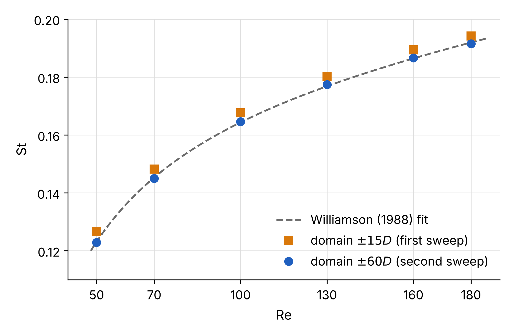
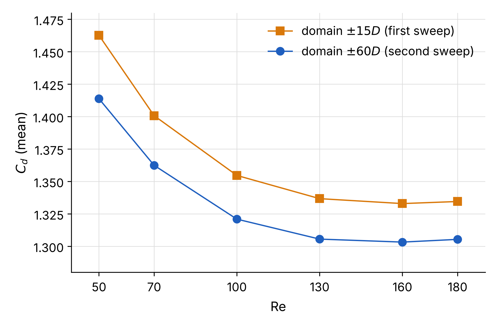

# Strouhal and Drag of a 2D Cylinder from $\mathrm{Re} = 50$ to $\mathrm{Re} = 180$: the Two Per Cent That Was the Domain

*Six laminar runs of a circular cylinder in Simcenter STAR-CCM+ gave Strouhal numbers 1 to 3% above Williamson's curve. Halving the cells and halving the time step changed nothing. Quadrupling the domain removed it. With the side boundaries at 60 diameters, every point of the curve sits within 0.35% of the experiment.*

Francisco Ezquerra Larrodé · November 2026

## The question

A circular cylinder starts to shed vortices near $\mathrm{Re} = 47$, its wake stays two-dimensional up to about $\mathrm{Re} = 190$, where the first three-dimensional mode appears, and inside that range one curve has been measured more carefully than almost any other in fluid mechanics: the Strouhal number against the Reynolds number. [Williamson (1988)](#references) fitted his parallel-shedding experiments with

$$\mathrm{St} = -\frac{3.3265}{\mathrm{Re}} + 0.1816 + 1.6 \times 10^{-4}\,\mathrm{Re},$$

and a 2D simulation that misses it by more than a per cent has something to explain. I had one validated run at $\mathrm{Re} = 100$, with $\mathrm{St} = 0.1677$ and $C_d = 1.355$. The plan was modest. Change the viscosity and nothing else, keep mesh, solver settings and post-processing exactly as they were, and see whether the same macros reproduce Williamson's curve from $\mathrm{Re} = 50$ to $\mathrm{Re} = 180$.

## Set-up

The fluid is non-dimensional, $\rho = U = D = 1$, so $\mu = 1/\mathrm{Re}$ and one macro sets it. The domain runs from 15 diameters upstream to 30 downstream, with symmetry planes at $\pm 15D$ across the flow, a velocity inlet and a pressure outlet; the mesh is a thin 3D trimmer mesh converted to 2D, with cells of $0.05D$ in a wake block from $-2D$ to $15D$ and $\pm 3D$, $0.025D$ on the cylinder, ten prism layers $0.1D$ deep, 52,971 cells in all. Laminar, implicit unsteady, second order in time, $\Delta t = 0.02\,D/U$, ten inner iterations per step. Each run starts from $u = 1$, $v = 0.01$. The wake needs a reason to break.

Every number below comes from whole shedding periods. The window opens at the first upward zero crossing of $C_l$ after a start time and closes at the last one before an end time, $\mathrm{St}$ is the count of periods divided by the window's length, and a run counts only if the two halves of its window agree to 0.1% in $C_d$ and in the rms of $C_l$. Near onset the wake grows slowly. At $\mathrm{Re} = 50$ the window is $t\,U/D = 700$ to 1000, at $\mathrm{Re} = 70$ it is 300 to 500, and from $\mathrm{Re} = 100$ upwards 100 to 300 is enough.

## First sweep: two per cent high

Every Strouhal number came out high. Not scattered around the curve, but above it by a steady margin: +2.9% at $\mathrm{Re} = 50$, +2.0% from $\mathrm{Re} = 70$ to $\mathrm{Re} = 130$, +1.6% at $\mathrm{Re} = 160$ and +1.2% at $\mathrm{Re} = 180$. A random error does not look like that. Something in the set-up was pushing all six runs the same way, and a little less at high Reynolds number, which already said where to look.

## What moves the Strouhal number

Three suspects, one run each at $\mathrm{Re} = 100$, every other setting held. A fourth run rebuilt the base mesh from scratch to check that macros and post-processing reproduce themselves.

| run at $\mathrm{Re} = 100$ | cells | $\mathrm{St}$ | $C_d$ | $C_l$ rms |
|---|---|---|---|---|
| base, rebuilt | 52,971 | 0.1677 | 1.355 | 0.2305 |
| cells halved near the cylinder and in the wake | 178,503 | 0.1677 | 1.354 | 0.2310 |
| $\Delta t = 0.01\,D/U$ | 52,971 | 0.1677 | 1.355 | 0.2305 |
| domain $\times 2$: $-30D$ to $60D$, $\pm 30D$ | 77,940 | 0.1656 | 1.331 | 0.2243 |
| domain $\times 4$: $-60D$ to $120D$, $\pm 60D$ | 179,040 | 0.1646 | 1.321 | 0.2215 |

Mesh and time step move nothing at the fourth digit. The domain moves everything. Each doubling of its size halves the drop in $\mathrm{St}$, from 0.0021 to 0.0010, which is what a correction linear in the blockage $D/H$ looks like, and taken to zero blockage the line gives $\mathrm{St} = 0.1636$ and $C_d = 1.310$. The run at $\pm 60D$, blockage 1/120, is already within 0.2% of Williamson at $\mathrm{Re} = 100$.

## Second sweep: the domain at sixty diameters

I ran the sweep again with the large domain and changed nothing else. A correction measured at $\mathrm{Re} = 100$ could not simply be applied to the first sweep, and this is why: from the small domain to the large one, $\mathrm{St}$ drops 3.0% at $\mathrm{Re} = 50$ and only 1.4% at $\mathrm{Re} = 180$, because a wake at low Reynolds number is wider and feels the side walls more. Six runs, then. Not one.

| $\mathrm{Re}$ | $\mathrm{St}$ | Williamson | difference | $C_d$ | $C_l$ rms | periods |
|---|---|---|---|---|---|---|
| 50 | 0.1229 | 0.1231 | -0.15% | 1.414 | 0.0343 | 36 |
| 70 | 0.1450 | 0.1453 | -0.20% | 1.362 | 0.1275 | 28 |
| 100 | 0.1646 | 0.1643 | +0.19% | 1.321 | 0.2215 | 32 |
| 130 | 0.1774 | 0.1768 | +0.34% | 1.305 | 0.3009 | 34 |
| 160 | 0.1866 | 0.1864 | +0.10% | 1.303 | 0.3724 | 37 |
| 180 | 0.1915 | 0.1919 | -0.23% | 1.305 | 0.4156 | 37 |

Williamson gives no drag. For $C_d$ and $C_l$ the reference is the 2D study of [Qu, Norberg, Davidson, Peng and Wang (2013)](#references), whose domain is square with its walls at $H/2$ and $H$ between 100 and 200 diameters, and where our Reynolds numbers meet theirs, at $\mathrm{Re} = 100$ and $\mathrm{Re} = 180$, Strouhal number and drag agree to 0.4%. At $\mathrm{Re} = 50$ our drag is 1.2% higher and our Strouhal number 0.9% lower than theirs. Their domain there is 200 diameters wide against our 120, and that may be all of it, though I have not run a third domain to check. For $\mathrm{Re} \ge 100$ the rms lift follows the fit of Norberg (2001), quoted by Qu et al., but sits below it, by 0.7 to 2.1%.

*Figure 1. Strouhal number against Reynolds number. Blue circles: domain at ±60D. Orange squares: domain at ±15D. Dashed line: Williamson's fit.*

*Figure 2. Mean drag coefficient, same runs and symbols. Williamson gives no drag, so this compares the two domains.*

## What this means for a capsule

The two per cent was never in the numerics. Mesh and time step were converged, the halves of every window agreed to better than 0.1%, and a reader who checked only those would have trusted a curve that was wrong in a way no residual shows. What gave it away was the shape of the error, the same sign at every Reynolds number, and a reference good to a fraction of a per cent.

A [Simulation Capsule](https://github.com/pacoEzq/simulation-capsule) of this case therefore has to carry the domain, not just the mesh: the distance to the side boundaries and their type, or the blockage $D/H$ outright. Two capsules of the same cylinder at $\mathrm{Re} = 100$, one with $\mathrm{St} = 0.1677$ and one with $\mathrm{St} = 0.1646$, are not two solvers disagreeing, they are two domains, and a language model reading them side by side cannot know that unless the capsule says so. The mesh does not tell it. The domain does.

## Limits

One mesh family and one solver. The domain test was done at $\mathrm{Re} = 100$ only, so that the large domain is enough elsewhere rests on the agreement with Williamson and not on a second test, and the rule linear in the blockage rests on three points. At $\mathrm{Re} = 50$ the shedding needed 700 time units to settle. A run that stopped at 300 would have looked converged to anyone who did not compare the halves of its window. Williamson's fit is for parallel shedding in the experiment, 2D runs have no end plates and no oblique mode, so a small offset would not have been a surprise. There was none.

## References

- C. H. K. Williamson, *Defining a universal and continuous Strouhal-Reynolds number relationship for the laminar vortex shedding of a circular cylinder*, Physics of Fluids 31, 2742 (1988), [doi:10.1063/1.866978](https://doi.org/10.1063/1.866978).
- L. Qu, C. Norberg, L. Davidson, S.-H. Peng and F. Wang, *Quantitative numerical analysis of flow past a circular cylinder at Reynolds number between 50 and 200*, Journal of Fluids and Structures 39, 347-370 (2013), [doi:10.1016/j.jfluidstructs.2013.02.007](https://doi.org/10.1016/j.jfluidstructs.2013.02.007).

## Files

- `data/sweep_60D.csv`: the six runs with the domain at $\pm 60D$ (St, mean $C_d$, rms and amplitude of $C_l$, window, cells).
- `data/sweep_15D.csv`: the six runs with the domain at $\pm 15D$.
- `data/sensitivity_re100.csv`: the five runs of the sensitivity table at $\mathrm{Re} = 100$.
- `scripts/plot_st_cd.py`: reads both sweeps and writes `figures/st_vs_re` and `figures/cd_vs_re` (PNG at 300 dpi and SVG).

Text, figures and data are [CC BY 4.0](../../LICENSE-DOCS); the script is [MIT](../../LICENSE).

Personal project by [Francisco Ezquerra Larrodé](https://github.com/pacoEzq), published with the [simulation-capsule](https://github.com/pacoEzq/simulation-capsule) repository. Views are my own.
