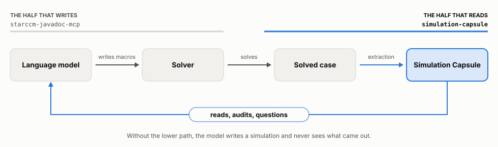
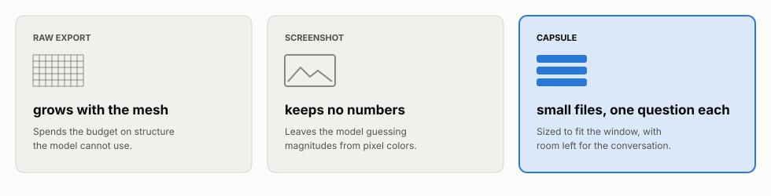
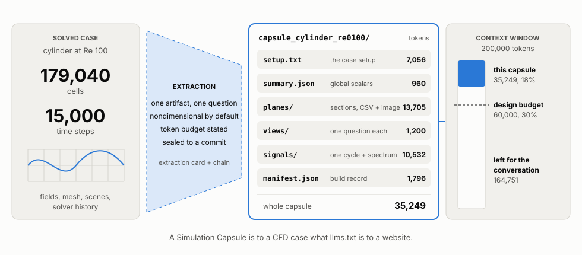
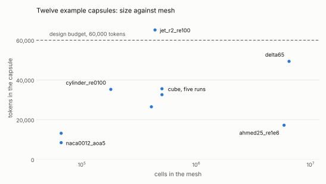
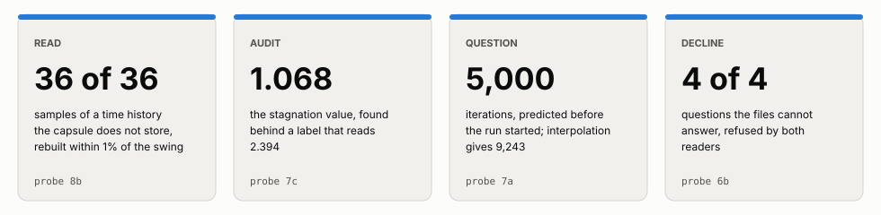
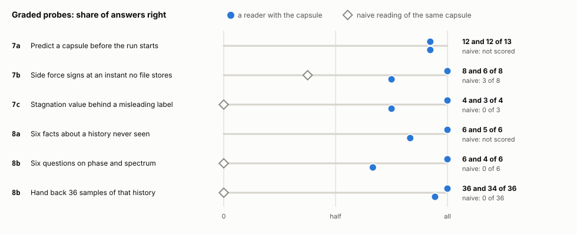
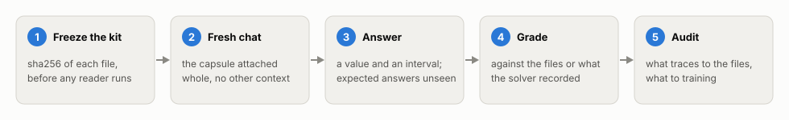

# Why a Simulation Capsule, in Five Steps

*Every number comes from this repository at commit `15e95b8`, read on 2026-11-24 in the ledger, the SPEC and the probe records linked beside each result.*

> [!IMPORTANT]
> **In two lines.** One half of AI-assisted CFD is writing the simulation. A capsule is the other half: what a model reads from a solved case, so that it can read the flow, audit the run and answer questions about both.

## Step 1: see the missing half

<picture>
  <source media="(prefers-color-scheme: dark)" srcset="figures/halves_dark.svg">
  
</picture>

[starccm-javadoc-mcp](https://github.com/pacoEzq/starccm-javadoc-mcp) teaches a model to write a simulation. This repository teaches it to read the results, which is the path the figure draws in blue. Remove it, and the loop stays open.

## Step 2: see why the two obvious moves fail

<picture>
  <source media="(prefers-color-scheme: dark)" srcset="figures/ways_dark.svg">
  
</picture>

A solved case is gigabytes, whereas a model reads a context window. Exporting raw data spends the budget on structure the model cannot use, and runs out long before anything interesting comes up; a screenshot throws away the numbers, the anchors of any answer, and leaves the model guessing at magnitudes from pixel colors. The capsule sits in between. It is a fixed directory of small files, each one an answer to a question somebody would ask about the case, and the whole fits in the window, with room left over.

> [!NOTE]
> This is the argument of the repository's README, not a measurement: no other input format went through the same questions as a capsule.

## Step 3: pack physics, not mesh cells

<picture>
  <source media="(prefers-color-scheme: dark)" srcset="figures/chain_dark.svg">
  
</picture>

The figure follows the cylinder capsule, with token counts from `tools/capsule_ledger.py`. Its budget is the one SPEC 3.5 declares: 60,000 tokens, 30 percent of a 200,000-token window. The rest stays free for the conversation.

### A mesh 100 times larger is not a prompt 100 times larger

<picture>
  <source media="(prefers-color-scheme: dark)" srcset="figures/cells_tokens_dark.svg">
  
</picture>

Across the twelve example capsules the mesh grows about 100 times, from 65,885 to 6,491,106 cells, and the capsule about 8 times, from 8,449 to 65,148 tokens. The two largest meshes are not the two largest capsules. The table sits beside this page, cells and tokens copied from the capsules and the ledger at that commit: [`data/cells_tokens.csv`](data/cells_tokens.csv).

> [!NOTE]
> Tokens are ledger estimates, at the rates the ledger declares. The jet capsule sits over the design budget, which the validator does not refuse.

## Step 4: see what a model did with one

<picture>
  <source media="(prefers-color-scheme: dark)" srcset="figures/cards_dark.svg">
  
</picture>

The capsule grew one layer at a time, in a ten-part tutorial series on the Simcenter community forum. Before a part went out, language models received its capsule whole, in a fresh conversation, and I graded every answer against the files or against what the solver had recorded. Those sessions sit in [`probes/`](https://github.com/pacoEzq/simulation-capsule/tree/15e95b86ce9f94d21cee352c5a927cc515803319/probes), prompts and transcripts included.

<picture>
  <source media="(prefers-color-scheme: dark)" srcset="figures/probes_dark.svg">
  
</picture>

The naive reading is the reference these probes carry, namely the same capsule with its summary taken at face value. Parts 1 to 5 had one reader, and Part 6 had four. From Part 6b on each probe had two, from two model families, and the figure shows those from Part 7a on. The records never rank them.

<details>
<summary><b>Read:</b> a history the capsule does not store, a force at one instant, a length from an image</summary>

- The cylinder run wrote 15,000 time steps, and its capsule keeps 32 phases of one cycle and a spectrum, in 10,532 tokens; from those, one reader rebuilt 36 of 36 recorded values at twelve instants drawn by seed, each within 1% of its signal's swing. The other rebuilt 34 of 36. [Part 8b](https://github.com/pacoEzq/simulation-capsule/blob/15e95b86ce9f94d21cee352c5a927cc515803319/probes/part-8b_cylinder_re0100.md)
- In three cube capsules the published side forces are means under 0.01 with standard deviations of 0.036 to 0.17, while the planes show one instant. Asked for the force at that instant, both readers held all three intervals. Taking the means at face value came out 9.5, 9.8 and 43.2 times too low. [Part 7b](https://github.com/pacoEzq/simulation-capsule/blob/15e95b86ce9f94d21cee352c5a927cc515803319/probes/part-7b_cube_re0100_re3000.md)
- The script gives a reverse flow extent of 0.45 body lengths behind the Ahmed body. Of four readers, three measured 0.40, 0.50 and 0.35 to 0.45 from one view. The fourth read 0.25 and named no method. It was also the one that got the regime wrong, having inferred an unsteady run from the name of a view file. [Part 6](https://github.com/pacoEzq/simulation-capsule/blob/15e95b86ce9f94d21cee352c5a927cc515803319/probes/part-6_ahmed25_re1e6.md)

</details>

<details>
<summary><b>Audit:</b> a setup nobody had seen, a capsule against itself, a label that says the wrong thing, an asymmetry that was not in the flow</summary>

- From `setup.txt` alone, a reader reviewing a thermal runaway case questioned two things: a boundary named Outlet, of type Wall, and a depletion threshold of 200 m/s set above a velocity limiter of 20 m/s, so that it may never fire. [Part 1](https://github.com/pacoEzq/simulation-capsule/blob/15e95b86ce9f94d21cee352c5a927cc515803319/probes/part-1_thermal_runaway.md)
- A reader derived the jet mass flow by hand from the inlet field function, got π/2, and placed the computed value 0.5% above it, which is the error the capsule reports. On the NACA 0012 a reader ran eleven independent cross-checks, each from file values or from a correlation it declared as external. All eleven passed. [Part 4](https://github.com/pacoEzq/simulation-capsule/blob/15e95b86ce9f94d21cee352c5a927cc515803319/probes/part-4_jet_r2_re100.md), [Part 2](https://github.com/pacoEzq/simulation-capsule/blob/15e95b86ce9f94d21cee352c5a927cc515803319/probes/part-2_naca0012_aoa5.md)
- `pressure.cp_stagnation` in the Re 100 cube reads 2.394, although it is the maximum over the cube faces, in a corner cell, and grows with every refinement of the mesh; both readers walked past the label and took the stagnation value, 1.068, from another field of the same capsule. Asked which way the 2.394 would move on a finer mesh, one said up, which is right, and the other said down. [Part 7c](https://github.com/pacoEzq/simulation-capsule/blob/15e95b86ce9f94d21cee352c5a927cc515803319/probes/part-7c_cube_re0100_re3000.md)
- A feature file reported an asymmetry of 0.086 at one station of a delta wing. The reader blamed the extraction, not the flow, and derived the mechanism from the method block. The reader passed nine questions of nine, and fabricated no value. [Part 5](https://github.com/pacoEzq/simulation-capsule/blob/15e95b86ce9f94d21cee352c5a927cc515803319/probes/part-5_delta65_a13p3_re1e6.md)

</details>

<details>
<summary><b>Question:</b> a run that had not started, another scale, two cases at once, and no answer where there is none</summary>

- Given four cube capsules of a Reynolds sweep, two readers predicted a fifth, at Re 600, with the run not yet started, and both read the convergence gate in `summary.json` and answered 5,000 iterations, the value later published. Interpolation in log Re gives 9,243, a count the run cannot stop at: after the first 1,000 iterations the gate checks every 2,000. [Part 7a](https://github.com/pacoEzq/simulation-capsule/blob/15e95b86ce9f94d21cee352c5a927cc515803319/probes/part-7a_cube_re0600.md)
- From the cylinder capsule both readers computed the lift cycles per hour on a 5 mm rod in water at the same Reynolds number: 2,370.8. It took one line of arithmetic. [Part 8a](https://github.com/pacoEzq/simulation-capsule/blob/15e95b86ce9f94d21cee352c5a927cc515803319/probes/part-8a_cylinder_re0100.md)
- From a base and a variant, both readers turned a lift change of 0.2049 over 2 degrees into 5.87 per radian, 93% of thin airfoil theory. Neither made an arithmetic error. [Part 6b](https://github.com/pacoEzq/simulation-capsule/blob/15e95b86ce9f94d21cee352c5a927cc515803319/probes/part-6b_naca0012_aoa5_aoa7.md)
- Asked for the stall angle, the shedding frequency, the finer of the two meshes and the changed fraction of the colored views, both readers refused all four. The files answer none of them, and the two cases share one mesh. [Part 6b](https://github.com/pacoEzq/simulation-capsule/blob/15e95b86ce9f94d21cee352c5a927cc515803319/probes/part-6b_naca0012_aoa5_aoa7.md)

</details>

### How a graded probe is run

<picture>
  <source media="(prefers-color-scheme: dark)" srcset="figures/strip_dark.svg">
  
</picture>

From Part 7a on, a sha256 of each file freezes the kit ahead of any reader. Where the capsule does not hold the truth, the solver supplies it: the monitor history, a point probe, a refinement series.

### What the record does not show

> [!IMPORTANT]
> These are review records, not benchmarks, and no other input format has faced the same questions.

- I issued the probes, ran the sessions and approved the scoring, alone, and in each session one reader shares a family with the model that helped write the records. The records say so.
- Where two capsules bracket a smooth trend, arithmetic is enough: on drag and side forces at Re 600, plain interpolation came closer than either reader.
- Both readers missed the side of the wake deficit on one plane at Re 600, although both had said beforehand that the files could not give it.
- One of four readers in Part 6 failed on a view whose title did not declare the regime. The view contract gained a rule from it.
- The probes found defects too. The table in `probes/README.md` lists them, most still open.
- All cases are canonical geometries, and all of them are mine.

## Step 5: try it, then build one

**Try it in two minutes.** Take the cylinder capsule, keep its folders, and attach it to a chat model that can open a zip:

```bash
git clone --depth 1 https://github.com/pacoEzq/simulation-capsule
cd simulation-capsule/examples
zip -r capsule_cylinder_re0100.zip capsule_cylinder_re0100
```

Start a fresh conversation, ask the model to read every file first, then put these three questions to it, from the [Part 8b](https://github.com/pacoEzq/simulation-capsule/blob/15e95b86ce9f94d21cee352c5a927cc515803319/probes/part-8b_cylinder_re0100.md) probe.

| Question | Expected | Where to check |
|---|---|---|
| On which bin of the spectrum does the line of `cd` fall, and which file says so? | bin 64, St 0.329278 | header of `signals/spectrum.csv` |
| What is the lag of the crest of `p1_v` behind the crest of `cl`, as a fraction of the cycle? | about 0.59 | `signals/phase_average.csv` |
| A steel rod 5 mm in diameter stands in water (kinematic viscosity 1.0e-6 m²/s) at the same Reynolds number. At what frequency does the drag on it fluctuate? | about 1.317 Hz | `signals/spectrum.csv`, `summary.json` |

A model that answers the third with about 0.66 Hz has used the shedding frequency of the lift, not the drag line.

**Build one for your case.** The analyst writes an extraction card, a small JSON file that names the body, its reference quantities, the plane stations and the views, each view with the question it answers. Four macros in [`macros/extractor/`](https://github.com/pacoEzq/simulation-capsule/tree/15e95b86ce9f94d21cee352c5a927cc515803319/macros/extractor) and `tools/extract_capsule.py` do the rest, after which `tools/check_capsule.py --strict` checks the result. When no card exists, `--propose-card` lets a model propose one, every entry marked `read` or `inferred`.

> [!NOTE]
> The recipes target Simcenter STAR-CCM+. Nobody has measured here what building a capsule costs in time.

## Files

- `data/cells_tokens.csv`: cells and ledger tokens of the twelve capsules in `examples/`. Cells from each `setup.txt`, and from `summary.json` for the Ahmed body.
- `scripts/plot_cells_tokens.py`: reads the table and writes the scatter, light and dark (SVG and PNG).
- `scripts/make_infographics.py`: writes the six infographics, light and dark (SVG). Its numbers are typed from the ledger, the SPEC and the probe records.

Text, figures and data are [CC BY 4.0](../../LICENSE-DOCS); the scripts are [MIT](../../LICENSE).

Personal project by [Francisco Ezquerra Larrodé](https://github.com/pacoEzq), published with the [simulation-capsule](https://github.com/pacoEzq/simulation-capsule) repository. Views are my own.
